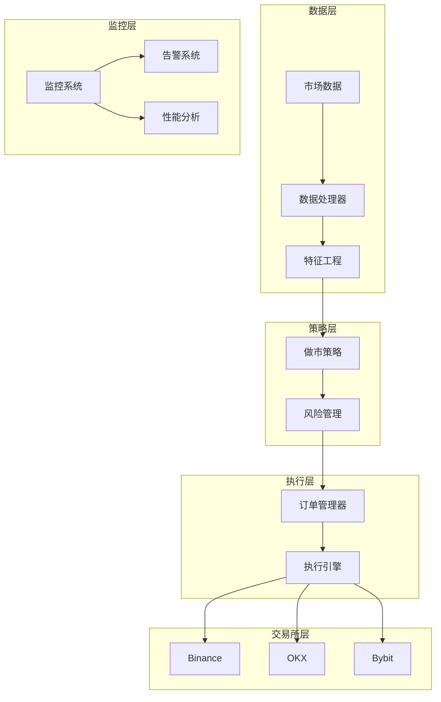

# 第19章：完整项目示例1：加密货币做市策略

## 学习目标

- 通过完整的项目实践，整合前面章节所学的知识
- 构建一个生产级的加密货币做市交易系统
- 学会处理真实交易中的各种挑战
- 理解从策略开发到部署的完整流程

## 19.1 项目概述

### 19.1.1 项目目标

本项目将构建一个加密货币做市交易系统，具备以下特点：

- **多交易所支持**：同时支持Binance、OKX、Bybit等主流交易所
- **动态做市**：根据市场波动率和流动性动态调整报价
- **风险管理**：内置多层风险控制机制
- **实时监控**：完整的性能监控和告警系统
- **高可用性**：支持热备份和故障自动恢复

### 19.1.2 系统架构



## 19.2 配置系统

### 19.2.1 配置文件结构

```yaml
# config/production.yaml
environment: production
logging:
  level: INFO
  file: logs/market_maker.log

# 数据源配置
data_sources:
  primary:
    exchange: binance
    symbols:
      - BTCUSDT
      - ETHUSDT
    channels:
      - depth
      - trades
      - ticker

  backup:
    exchange: okx
    symbols:
      - BTC-USDT
      - ETH-USDT

# 策略配置
strategy:
  name: DynamicMarketMaker
  parameters:
    base_spread_bps: 10          # 基础价差(基点)
    inventory_target: 0.0        # 目标持仓比例
    max_position: 50.0           # 最大持仓(BTC)
    order_levels: 5              # 报价层数
    order_size_base: 0.1         # 基础订单大小(BTC)
    skew_factor: 0.5             # 库存偏斜因子
    volatility_window: 100       # 波动率计算窗口
    quote_refresh_rate: 1.0      # 报价刷新频率(秒)

# 风险管理配置
risk:
  max_daily_loss: 10000         # 最大日损失(USDT)
  max_drawdown: 0.05            # 最大回撤(5%)
  position_limit: {
    BTC: 50.0
    ETH: 1000.0
  }
  leverage_limit: 3.0           # 杠杆限制

# 执行配置
execution:
  order_type: limit
  time_in_force: GTC
  max_orders_per_second: 10
  retry_attempts: 3
  order_timeout: 30

# 监控配置
monitoring:
  metrics_interval: 5           # 指标收集间隔(秒)
  health_check_interval: 30     # 健康检查间隔(秒)
  alert_channels:
    - email
    - slack

  performance_metrics:
    - pnl
    - inventory
    - order_fill_rate
    - latency
    - error_rate

# 数据库配置
database:
  type: postgresql
  host: localhost
  port: 5432
  database: market_maker
  username: nautilus
  password: ${DB_PASSWORD}

# Redis配置（缓存）
redis:
  host: localhost
  port: 6379
  db: 0

# API配置
api:
  enabled: true
  host: 0.0.0.0
  port: 8080
  authentication: true
```

### 19.2.2 配置管理器

```python
# src/config/config_manager.py
import os
import yaml
from typing import Dict, Any
from pathlib import Path
from dotenv import load_dotenv

class ConfigManager:
    """配置管理器"""

    def __init__(self, config_path: str = "config/production.yaml"):
        # 加载环境变量
        load_dotenv()

        # 加载配置文件
        self.config_path = Path(config_path)
        self.config = self._load_config()

        # 处理环境变量替换
        self.config = self._substitute_env_vars(self.config)

    def _load_config(self) -> Dict[str, Any]:
        """加载配置文件"""
        with open(self.config_path, 'r') as f:
            return yaml.safe_load(f)

    def _substitute_env_vars(self, config: Any) -> Any:
        """替换环境变量"""
        if isinstance(config, dict):
            return {k: self._substitute_env_vars(v) for k, v in config.items()}
        elif isinstance(config, list):
            return [self._substitute_env_vars(item) for item in config]
        elif isinstance(config, str) and config.startswith('${') and config.endswith('}'):
            env_var = config[2:-1]
            default_value = None
            if ':' in env_var:
                env_var, default_value = env_var.split(':', 1)
            return os.getenv(env_var, default_value)
        else:
            return config

    def get(self, key: str, default=None):
        """获取配置值"""
        keys = key.split('.')
        value = self.config

        for k in keys:
            if isinstance(value, dict) and k in value:
                value = value[k]
            else:
                return default

        return value

    def update(self, key: str, value: Any):
        """更新配置值"""
        keys = key.split('.')
        config = self.config

        for k in keys[:-1]:
            if k not in config:
                config[k] = {}
            config = config[k]

        config[keys[-1]] = value

    def save(self):
        """保存配置到文件"""
        with open(self.config_path, 'w') as f:
            yaml.dump(self.config, f, default_flow_style=False)
```

## 19.3 数据管理模块

### 19.3.1 统一数据接口

```python
# src/data/unified_data_client.py
from typing import Dict, List, Callable, Optional
from dataclasses import dataclass
import asyncio
import aiohttp
import websockets
from decimal import Decimal

@dataclass
class MarketData:
    """市场数据结构"""
    symbol: str
    exchange: str
    timestamp: int
    bid: Decimal
    ask: Decimal
    bid_size: Decimal
    ask_size: Decimal
    last_price: Optional[Decimal] = None
    volume: Optional[Decimal] = None

class UnifiedDataClient:
    """统一数据客户端"""

    def __init__(self, config_manager: ConfigManager):
        self.config = config_manager
        self.clients = {}  # 各交易所客户端
        self.data_cache = {}
        self.subscribers = {
            'quotes': [],
            'trades': [],
            'bars': []
        }

    async def initialize(self):
        """初始化所有数据客户端"""
        # 主数据源
        primary_config = self.config.get('data_sources.primary')
        await self._add_exchange_client(
            primary_config['exchange'],
            primary_config,
            is_primary=True
        )

        # 备份数据源
        backup_config = self.config.get('data_sources.backup')
        if backup_config:
            await self._add_exchange_client(
                backup_config['exchange'],
                backup_config,
                is_primary=False
            )

    async def _add_exchange_client(self, exchange: str, config: dict, is_primary: bool):
        """添加交易所客户端"""
        if exchange == 'binance':
            client = BinanceDataClient(config)
        elif exchange == 'okx':
            client = OKXDataClient(config)
        elif exchange == 'bybit':
            client = BybitDataClient(config)
        else:
            raise ValueError(f"Unsupported exchange: {exchange}")

        await client.initialize()
        self.clients[exchange] = {
            'client': client,
            'is_primary': is_primary,
            'config': config
        }

        # 订阅数据流
        for symbol in config['symbols']:
            await self._subscribe_symbol(exchange, symbol, config['channels'])

    async def _subscribe_symbol(self, exchange: str, symbol: str, channels: List[str]):
        """订阅交易对数据"""
        client_info = self.clients[exchange]
        client = client_info['client']

        for channel in channels:
            if channel == 'depth':
                await client.subscribe_depth(symbol, self._on_depth_update)
            elif channel == 'trades':
                await client.subscribe_trades(symbol, self._on_trade_update)
            elif channel == 'ticker':
                await client.subscribe_ticker(symbol, self._on_ticker_update)

    async def _on_depth_update(self, data: MarketData):
        """处理深度更新"""
        # 缓存最新数据
        cache_key = f"{data.symbol}_{data.exchange}"
        self.data_cache[cache_key] = data

        # 通知订阅者
        for callback in self.subscribers['quotes']:
            await callback(data)

    async def _on_trade_update(self, data: MarketData):
        """处理成交更新"""
        for callback in self.subscribers['trades']:
            await callback(data)

    async def _on_ticker_update(self, data: MarketData):
        """处理行情更新"""
        # 更新价格信息
        cache_key = f"{data.symbol}_{data.exchange}"
        if cache_key in self.data_cache:
            self.data_cache[cache_key].last_price = data.last_price
            self.data_cache[cache_key].volume = data.volume

    def subscribe_quotes(self, callback: Callable[[MarketData], None]):
        """订阅报价数据"""
        self.subscribers['quotes'].append(callback)

    def subscribe_trades(self, callback: Callable[[MarketData], None]):
        """订阅成交数据"""
        self.subscribers['trades'].append(callback)

    def get_latest_quote(self, symbol: str) -> Optional[MarketData]:
        """获取最新报价"""
        # 优先返回主数据源
        for exchange, client_info in self.clients.items():
            if client_info['is_primary']:
                cache_key = f"{symbol}_{exchange}"
                if cache_key in self.data_cache:
                    return self.data_cache[cache_key]

        # 如果主数据源不可用，返回备用数据源
        for exchange, client_info in self.clients.items():
            if not client_info['is_primary']:
                cache_key = f"{symbol}_{exchange}"
                if cache_key in self.data_cache:
                    return self.data_cache[cache_key]

        return None

# 交易所特定客户端
class BinanceDataClient:
    """Binance数据客户端"""

    def __init__(self, config: dict):
        self.config = config
        self.ws_url = "wss://stream.binance.com:9443/ws"
        self.rest_url = "https://api.binance.com"
        self.websocket = None
        self.subscriptions = {}

    async def initialize(self):
        """初始化连接"""
        # WebSocket连接
        self.websocket = await websockets.connect(self.ws_url)

        # 启动消息处理
        asyncio.create_task(self._message_loop())

    async def subscribe_depth(self, symbol: str, callback: Callable):
        """订阅深度数据"""
        stream = f"{symbol.lower()}@depth"
        await self.websocket.send(json.dumps({
            "method": "SUBSCRIBE",
            "params": [stream],
            "id": len(self.subscriptions)
        }))
        self.subscriptions[stream] = callback

    async def subscribe_trades(self, symbol: str, callback: Callable):
        """订阅成交数据"""
        stream = f"{symbol.lower()}@trade"
        await self.websocket.send(json.dumps({
            "method": "SUBSCRIBE",
            "params": [stream],
            "id": len(self.subscriptions)
        }))
        self.subscriptions[stream] = callback

    async def _message_loop(self):
        """消息处理循环"""
        async for message in self.websocket:
            data = json.loads(message)

            if 'stream' in data:
                stream = data['stream']
                if stream in self.subscriptions:
                    await self._process_stream_data(stream, data['data'])

    async def _process_stream_data(self, stream: str, data: dict):
        """处理流数据"""
        if 'depth' in stream:
            market_data = self._parse_depth_data(data)
        elif 'trade' in stream:
            market_data = self._parse_trade_data(data)
        else:
            return

        await self.subscriptions[stream](market_data)

    def _parse_depth_data(self, data: dict) -> MarketData:
        """解析深度数据"""
        return MarketData(
            symbol=data['s'],
            exchange='binance',
            timestamp=data['E'],
            bid=Decimal(str(data['bids'][0][0])),
            ask=Decimal(str(data['asks'][0][0])),
            bid_size=Decimal(str(data['bids'][0][1])),
            ask_size=Decimal(str(data['asks'][0][1]))
        )

    def _parse_trade_data(self, data: dict) -> MarketData:
        """解析成交数据"""
        return MarketData(
            symbol=data['s'],
            exchange='binance',
            timestamp=data['T'],
            bid=Decimal('0'),
            ask=Decimal('0'),
            bid_size=Decimal('0'),
            ask_size=Decimal('0'),
            last_price=Decimal(str(data['p'])),
            volume=Decimal(str(data['q']))
        )
```

## 19.4 做市策略实现

### 19.4.1 核心策略类

```python
# src/strategies/market_maker.py
import asyncio
import numpy as np
from decimal import Decimal
from typing import Dict, List, Optional
from nautilus_trader.strategy import Strategy
from nautilus_trader.model.data import QuoteTick
from nautilus_trader.model.events import OrderFilled
from nautilus_trader.model.enums import OrderSide, OrderType
from nautilus_trader.model.objects import Quantity, Price
from nautilus_trader.adapters.betfair.providers import BetfairInstrumentProvider
from nautilus_trader.model.identifiers import InstrumentId

class DynamicMarketMaker(Strategy):
    """动态做市策略"""

    def __init__(self, config: dict):
        super().__init__()

        # 策略参数
        self.symbols = config['symbols']
        self.base_spread = Decimal(str(config['base_spread_bps'])) / Decimal('10000')
        self.max_position = Decimal(str(config['max_position']))
        self.order_levels = config['order_levels']
        self.order_size_base = Decimal(str(config['order_size_base']))
        self.skew_factor = config['skew_factor']
        self.volatility_window = config['volatility_window']
        self.quote_refresh_rate = config['quote_refresh_rate']

        # 状态变量
        self.positions = {symbol: Decimal('0') for symbol in self.symbols}
        self.mid_prices = {symbol: Decimal('0') for symbol in self.symbols}
        self.volatilities = {symbol: Decimal('0.01') for symbol in self.symbols}
        self.price_history = {symbol: [] for symbol in self.symbols}
        self.active_orders = {symbol: {} for symbol in self.symbols}

        # 性能统计
        self.trade_count = 0
        self.total_pnl = Decimal('0')
        self.quote_updates = 0

    def on_start(self):
        """策略启动"""
        # 订阅所有交易对的报价数据
        for symbol in self.symbols:
            self.subscribe_quote_ticks(InstrumentId.from_str(symbol))

        # 启动报价更新任务
        asyncio.create_task(self._quote_update_loop())

        # 启动风险监控任务
        asyncio.create_task(self._risk_monitor_loop())

        self.log.info(f"DynamicMarketMaker started for symbols: {self.symbols}")

    async def _quote_update_loop(self):
        """报价更新循环"""
        while True:
            try:
                for symbol in self.symbols:
                    await self._update_quotes(symbol)
                await asyncio.sleep(self.quote_refresh_rate)
            except Exception as e:
                self.log.error(f"Quote update error: {e}")
                await asyncio.sleep(1)

    async def _update_quotes(self, symbol: str):
        """更新特定交易对的报价"""
        # 获取当前报价
        quote = self.cache.quote_tick(InstrumentId.from_str(symbol))
        if not quote:
            return

        # 更新中价和价格历史
        mid_price = (quote.bid + quote.ask) / 2
        self.mid_prices[symbol] = mid_price
        self.price_history[symbol].append(float(mid_price))

        # 保持固定窗口大小
        if len(self.price_history[symbol]) > self.volatility_window:
            self.price_history[symbol].pop(0)

        # 更新波动率
        self._update_volatility(symbol)

        # 取消现有订单
        await self._cancel_all_orders(symbol)

        # 计算新订单
        orders = self._calculate_orders(symbol, quote)

        # 下新订单
        for order_config in orders:
            await self._place_order(symbol, order_config)

        self.quote_updates += 1

    def _update_volatility(self, symbol: str):
        """更新波动率"""
        if len(self.price_history[symbol]) < 20:
            return

        # 计算对数收益率
        prices = np.array(self.price_history[symbol])
        log_returns = np.diff(np.log(prices))

        # 年化波动率
        volatility = np.std(log_returns) * np.sqrt(365 * 24 * 60)  # 假设分钟数据
        self.volatilities[symbol] = Decimal(str(volatility))

    def _calculate_orders(self, symbol: str, quote: QuoteTick) -> List[dict]:
        """计算订单"""
        orders = []
        mid_price = self.mid_prices[symbol]
        position = self.positions[symbol]
        volatility = self.volatilities[symbol]

        # 计算动态价差
        # 基础价差 + 波动率调整
        spread_adjustment = volatility * Decimal('2')  # 2倍标准差
        total_spread = self.base_spread + spread_adjustment

        # 计算库存偏斜
        inventory_ratio = position / self.max_position
        skew_adjustment = inventory_ratio * self.skew_factor * total_spread

        # 生成多档报价
        for level in range(self.order_levels):
            # 递增价差
            level_multiplier = 1 + (level * 0.2)

            # 买价
            bid_spread = total_spread * level_multiplier * (1 + skew_adjustment)
            bid_price = mid_price - bid_spread
            bid_size = self._calculate_order_size(
                symbol, OrderSide.BUY, position, level
            )

            # 卖价
            ask_spread = total_spread * level_multiplier * (1 - skew_adjustment)
            ask_price = mid_price + ask_spread
            ask_size = self._calculate_order_size(
                symbol, OrderSide.SELL, position, level
            )

            if bid_size > 0:
                orders.append({
                    'side': OrderSide.BUY,
                    'price': bid_price,
                    'size': bid_size,
                    'level': level
                })

            if ask_size > 0:
                orders.append({
                    'side': OrderSide.SELL,
                    'price': ask_price,
                    'size': ask_size,
                    'level': level
                })

        return orders

    def _calculate_order_size(self, symbol: str, side: OrderSide,
                             position: Decimal, level: int) -> Quantity:
        """计算订单大小"""
        base_size = self.order_size_base

        # 根据档位递减
        size_multiplier = Decimal(str(1 - (level * 0.1)))

        # 根据库存调整
        if side == OrderSide.BUY and position > 0:
            # 多头持仓，减少买单
            inventory_factor = max(Decimal('0'), 1 - abs(position / self.max_position))
        elif side == OrderSide.SELL and position < 0:
            # 空头持仓，减少卖单
            inventory_factor = max(Decimal('0'), 1 - abs(position / self.max_position))
        else:
            inventory_factor = Decimal('1')

        # 计算最终大小
        final_size = base_size * size_multiplier * inventory_factor

        # 确保最小订单大小
        min_size = Decimal('0.001')
        final_size = max(final_size, min_size)

        return Quantity.from_int(int(final_size))

    async def _place_order(self, symbol: str, order_config: dict):
        """下订单"""
        order = self.order_factory.limit(
            instrument_id=InstrumentId.from_str(symbol),
            side=order_config['side'],
            price=order_config['price'],
            quantity=order_config['size']
        )

        order_id = await self.submit_order(order)

        # 记录活动订单
        self.active_orders[symbol][order_id] = {
            'config': order_config,
            'timestamp': self.clock.timestamp_ns()
        }

    async def _cancel_all_orders(self, symbol: str):
        """取消所有订单"""
        for order_id in list(self.active_orders[symbol].keys()):
            await self.cancel_order(order_id)
            del self.active_orders[symbol][order_id]

    def on_order_filled(self, event: OrderFilled):
        """处理订单成交"""
        # 更新持仓
        symbol = str(event.instrument_id)
        if event.side == OrderSide.BUY:
            self.positions[symbol] += event.filled_qty
        else:
            self.positions[symbol] -= event.filled_qty

        # 更新统计
        self.trade_count += 1
        # PnL计算会在持仓事件中更新

        self.log.info(f"Order filled: {event.instrument_id} {event.side} {event.filled_qty} @ {event.last_px}")

    async def _risk_monitor_loop(self):
        """风险监控循环"""
        while True:
            try:
                await self._check_risk_limits()
                await asyncio.sleep(10)  # 每10秒检查一次
            except Exception as e:
                self.log.error(f"Risk monitor error: {e}")
                await asyncio.sleep(5)

    async def _check_risk_limits(self):
        """检查风险限制"""
        for symbol in self.symbols:
            position = self.positions[symbol]

            # 检查持仓限制
            if abs(position) > self.max_position:
                self.log.warning(f"Position limit exceeded for {symbol}: {position}")
                # 强制平仓
                await self._emergency_close(symbol)

            # 检查订单数量
            if len(self.active_orders[symbol]) > self.order_levels * 2 * len(self.symbols):
                self.log.warning(f"Too many orders for {symbol}: {len(self.active_orders[symbol])}")
                # 取消部分订单
                await self._cancel_excess_orders(symbol)

    async def _emergency_close(self, symbol: str):
        """紧急平仓"""
        position = self.positions[symbol]
        if position == 0:
            return

        # 取消所有订单
        await self._cancel_all_orders(symbol)

        # 下市价单平仓
        side = OrderSide.SELL if position > 0 else OrderSide.BUY
        order = self.order_factory.market(
            instrument_id=InstrumentId.from_str(symbol),
            side=side,
            quantity=Quantity.from_int(abs(int(position)))
        )

        await self.submit_order(order)
        self.log.critical(f"Emergency close position for {symbol}: {position}")

    async def _cancel_excess_orders(self, symbol: str):
        """取消多余订单"""
        orders = list(self.active_orders[symbol].items())
        # 保留价格最优的几个订单
        orders.sort(key=lambda x: x[1]['config']['level'])

        max_orders = self.order_levels * 2  # 双边总订单数
        for order_id, _ in orders[max_orders:]:
            await self.cancel_order(order_id)
            del self.active_orders[symbol][order_id]

    def get_strategy_metrics(self) -> Dict:
        """获取策略指标"""
        return {
            'positions': {symbol: float(pos) for symbol, pos in self.positions.items()},
            'mid_prices': {symbol: float(price) for symbol, price in self.mid_prices.items()},
            'volatilities': {symbol: float(vol) for symbol, vol in self.volatilities.items()},
            'active_orders': {symbol: len(orders) for symbol, orders in self.active_orders.items()},
            'total_trades': self.trade_count,
            'quote_updates': self.quote_updates,
            'total_pnl': float(self.total_pnl)
        }
```

## 19.5 风险管理系统

### 19.5.1 风险引擎

```python
# src/risk/risk_engine.py
from decimal import Decimal
from typing import Dict, List, Optional
from dataclasses import dataclass
from datetime import datetime, timedelta
import asyncio

@dataclass
class RiskAlert:
    """风险告警"""
    level: str  # INFO, WARNING, CRITICAL
    message: str
    timestamp: datetime
    details: dict

class RiskEngine:
    """风险管理引擎"""

    def __init__(self, config: dict):
        self.config = config

        # 风险限制
        self.max_daily_loss = Decimal(str(config.get('max_daily_loss', 10000)))
        self.max_drawdown = Decimal(str(config.get('max_drawdown', 0.05)))
        self.position_limits = {
            symbol: Decimal(str(limit))
            for symbol, limit in config.get('position_limit', {}).items()
        }
        self.leverage_limit = Decimal(str(config.get('leverage_limit', 3.0)))

        # 监控指标
        self.daily_pnl = Decimal('0')
        self.max_portfolio_value = Decimal('0')
        self.daily_high_water_mark = Decimal('0')
        self.start_of_day_value = Decimal('0')

        # 告警历史
        self.alerts = []
        self.alert_handlers = []

        # 监控任务
        self.monitoring_active = True

    async def start_monitoring(self):
        """启动风险监控"""
        # 重置每日指标
        self._reset_daily_metrics()

        # 启动监控任务
        asyncio.create_task(self._monitoring_loop())
        asyncio.create_task(self._daily_reset_loop())

    async def stop_monitoring(self):
        """停止风险监控"""
        self.monitoring_active = False

    async def _monitoring_loop(self):
        """监控循环"""
        while self.monitoring_active:
            try:
                await self._check_all_risks()
                await asyncio.sleep(1)  # 每秒检查
            except Exception as e:
                self.log.error(f"Risk monitoring error: {e}")
                await asyncio.sleep(5)

    async def _daily_reset_loop(self):
        """每日重置循环"""
        while self.monitoring_active:
            # 等待到午夜
            now = datetime.now()
            next_midnight = now.replace(hour=0, minute=0, second=0, microsecond=0) + timedelta(days=1)
            sleep_seconds = (next_midnight - now).total_seconds()

            await asyncio.sleep(sleep_seconds)
            self._reset_daily_metrics()

    def _reset_daily_metrics(self):
        """重置每日指标"""
        self.daily_pnl = Decimal('0')
        self.start_of_day_value = self._get_current_portfolio_value()
        self.daily_high_water_mark = self.start_of_day_value
        self.log.info("Daily risk metrics reset")

    async def _check_all_risks(self):
        """检查所有风险"""
        # 检查持仓限制
        await self._check_position_limits()

        # 检查日损失
        await self._check_daily_loss()

        # 检查回撤
        await self._check_drawdown()

        # 检查杠杆
        await self._check_leverage()

        # 检查订单风险
        await self._check_order_risks()

    async def _check_position_limits(self):
        """检查持仓限制"""
        positions = self._get_current_positions()

        for symbol, position in positions.items():
            if symbol in self.position_limits:
                limit = self.position_limits[symbol]
                if abs(position) > limit:
                    await self._trigger_alert(
                        level='CRITICAL',
                        message=f"Position limit exceeded for {symbol}",
                        details={
                            'symbol': symbol,
                            'position': float(position),
                            'limit': float(limit)
                        }
                    )

    async def _check_daily_loss(self):
        """检查日损失"""
        current_value = self._get_current_portfolio_value()
        daily_pnl = current_value - self.start_of_day_value

        if -daily_pnl > self.max_daily_loss:
            await self._trigger_alert(
                level='CRITICAL',
                message="Daily loss limit exceeded",
                details={
                    'daily_loss': float(-daily_pnl),
                    'limit': float(self.max_daily_loss),
                    'daily_pnl': float(daily_pnl)
                }
            )
        elif -daily_pnl > self.max_daily_loss * Decimal('0.8'):
            await self._trigger_alert(
                level='WARNING',
                message="Approaching daily loss limit",
                details={
                    'daily_loss': float(-daily_pnl),
                    'limit': float(self.max_daily_loss),
                    'utilization': float(-daily_pnl / self.max_daily_loss)
                }
            )

    async def _check_drawdown(self):
        """检查回撤"""
        current_value = self._get_current_portfolio_value()

        # 更新最高水位
        self.max_portfolio_value = max(self.max_portfolio_value, current_value)

        # 计算回撤
        if self.max_portfolio_value > 0:
            drawdown = (self.max_portfolio_value - current_value) / self.max_portfolio_value

            if drawdown > self.max_drawdown:
                await self._trigger_alert(
                    level='CRITICAL',
                    message="Maximum drawdown exceeded",
                    details={
                        'drawdown': float(drawdown),
                        'limit': float(self.max_drawdown),
                        'current_value': float(current_value),
                        'peak_value': float(self.max_portfolio_value)
                    }
                )
            elif drawdown > self.max_drawdown * Decimal('0.8):
                await self._trigger_alert(
                    level='WARNING',
                    message="Approaching maximum drawdown",
                    details={
                        'drawdown': float(drawdown),
                        'limit': float(self.max_drawdown)
                    }
                )

    async def _check_leverage(self):
        """检查杠杆"""
        total_position_value = self._get_total_position_value()
        current_value = self._get_current_portfolio_value()

        if current_value > 0:
            leverage = total_position_value / current_value

            if leverage > self.leverage_limit:
                await self._trigger_alert(
                    level='WARNING',
                    message="Leverage limit exceeded",
                    details={
                        'leverage': float(leverage),
                        'limit': float(self.leverage_limit)
                    }
                )

    async def _check_order_risks(self):
        """检查订单风险"""
        # 检查订单集中度
        # 检查大额订单
        # 检查订单频率
        pass

    async def _trigger_alert(self, level: str, message: str, details: dict):
        """触发风险告警"""
        alert = RiskAlert(
            level=level,
            message=message,
            timestamp=datetime.now(),
            details=details
        )

        self.alerts.append(alert)

        # 通知所有处理器
        for handler in self.alert_handlers:
            try:
                await handler(alert)
            except Exception as e:
                self.log.error(f"Alert handler error: {e}")

    def add_alert_handler(self, handler):
        """添加告警处理器"""
        self.alert_handlers.append(handler)

    def get_risk_summary(self) -> dict:
        """获取风险摘要"""
        return {
            'daily_pnl': float(self.daily_pnl),
            'max_drawdown': float(self._calculate_current_drawdown()),
            'leverage': float(self._get_current_leverage()),
            'alert_count': len(self.alerts),
            'critical_alerts': len([a for a in self.alerts if a.level == 'CRITICAL']),
            'position_utilization': self._get_position_utilization()
        }

    # 以下方法需要与实际系统集成
    def _get_current_portfolio_value(self) -> Decimal:
        """获取当前组合价值"""
        # 实现获取组合价值的逻辑
        return Decimal('100000')  # 示例值

    def _get_current_positions(self) -> Dict[str, Decimal]:
        """获取当前持仓"""
        # 实现获取持仓的逻辑
        return {}  # 示例值

    def _get_total_position_value(self) -> Decimal:
        """获取总持仓价值"""
        # 实现计算总持仓价值的逻辑
        return Decimal('50000')  # 示例值

    def _calculate_current_drawdown(self) -> Decimal:
        """计算当前回撤"""
        current_value = self._get_current_portfolio_value()
        if self.max_portfolio_value > 0:
            return (self.max_portfolio_value - current_value) / self.max_portfolio_value
        return Decimal('0')

    def _get_current_leverage(self) -> Decimal:
        """获取当前杠杆"""
        total_position_value = self._get_total_position_value()
        current_value = self._get_current_portfolio_value()

        if current_value > 0:
            return total_position_value / current_value
        return Decimal('0')

    def _get_position_utilization(self) -> dict:
        """获取持仓利用率"""
        positions = self._get_current_positions()
        utilization = {}

        for symbol, position in positions.items():
            if symbol in self.position_limits:
                limit = self.position_limits[symbol]
                if limit > 0:
                    utilization[symbol] = float(abs(position) / limit)
                else:
                    utilization[symbol] = 0.0
            else:
                utilization[symbol] = 0.0

        return utilization
```

## 19.6 监控和告警系统

### 19.6.1 性能监控

```python
# src/monitoring/performance_monitor.py
import time
import psutil
import asyncio
from datetime import datetime, timedelta
from typing import Dict, List
import pandas as pd
import plotly.graph_objects as go
import plotly.express as px
from prometheus_client import Gauge, Counter, Histogram, start_http_server

class PerformanceMonitor:
    """性能监控器"""

    def __init__(self, config: dict):
        self.config = config
        self.metrics_interval = config.get('metrics_interval', 5)
        self.health_check_interval = config.get('health_check_interval', 30)

        # Prometheus指标
        self.setup_prometheus_metrics()

        # 性能数据存储
        self.metrics_history = {
            'timestamp': [],
            'cpu_usage': [],
            'memory_usage': [],
            'latency': [],
            'throughput': [],
            'error_rate': [],
            'pnl': []
        }

        # 监控状态
        self.monitoring_active = False
        self.start_time = None

    def setup_prometheus_metrics(self):
        """设置Prometheus指标"""
        # 系统指标
        self.cpu_gauge = Gauge('trading_system_cpu_usage', 'CPU usage percentage')
        self.memory_gauge = Gauge('trading_system_memory_usage', 'Memory usage percentage')

        # 业务指标
        self.pnl_gauge = Gauge('trading_system_pnl', 'Current PnL')
        self.position_gauge = Gauge('trading_system_position', 'Current position size')
        self.order_latency = Histogram('trading_order_latency_seconds', 'Order latency in seconds')
        self.order_counter = Counter('trading_orders_total', 'Total orders')
        self.trade_counter = Counter('trading_trades_total', 'Total trades')
        self.error_counter = Counter('trading_errors_total', 'Total errors')

    async def start_monitoring(self, port: int = 8000):
        """启动监控"""
        self.monitoring_active = True
        self.start_time = datetime.now()

        # 启动Prometheus HTTP服务器
        start_http_server(port)

        # 启动监控任务
        asyncio.create_task(self._metrics_collection_loop())
        asyncio.create_task(self._health_check_loop())
        asyncio.create_task(self._performance_analysis_loop())

        self.log.info(f"Performance monitoring started on port {port}")

    async def stop_monitoring(self):
        """停止监控"""
        self.monitoring_active = False
        self.log.info("Performance monitoring stopped")

    async def _metrics_collection_loop(self):
        """指标收集循环"""
        while self.monitoring_active:
            try:
                # 收集系统指标
                cpu_percent = psutil.cpu_percent()
                memory_percent = psutil.virtual_memory().percent

                # 更新Prometheus指标
                self.cpu_gauge.set(cpu_percent)
                self.memory_gauge.set(memory_percent)

                # 存储历史数据
                timestamp = datetime.now()
                self.metrics_history['timestamp'].append(timestamp)
                self.metrics_history['cpu_usage'].append(cpu_percent)
                self.metrics_history['memory_usage'].append(memory_percent)

                # 保持固定长度
                max_history = 1000
                for key in self.metrics_history:
                    if len(self.metrics_history[key]) > max_history:
                        self.metrics_history[key].pop(0)

                await asyncio.sleep(self.metrics_interval)

            except Exception as e:
                self.log.error(f"Metrics collection error: {e}")
                await asyncio.sleep(5)

    async def _health_check_loop(self):
        """健康检查循环"""
        while self.monitoring_active:
            try:
                await self._perform_health_check()
                await asyncio.sleep(self.health_check_interval)
            except Exception as e:
                self.log.error(f"Health check error: {e}")
                await asyncio.sleep(10)

    async def _perform_health_check(self):
        """执行健康检查"""
        health_status = {
            'timestamp': datetime.now(),
            'status': 'healthy',
            'checks': {}
        }

        # CPU使用率检查
        cpu_usage = psutil.cpu_percent()
        health_status['checks']['cpu'] = {
            'status': 'ok' if cpu_usage < 80 else 'warning',
            'value': cpu_usage
        }

        # 内存使用率检查
        memory_usage = psutil.virtual_memory().percent
        health_status['checks']['memory'] = {
            'status': 'ok' if memory_usage < 85 else 'warning',
            'value': memory_usage
        }

        # 磁盘空间检查
        disk_usage = psutil.disk_usage('/').percent
        health_status['checks']['disk'] = {
            'status': 'ok' if disk_usage < 90 else 'warning',
            'value': disk_usage
        }

        # 检查整体状态
        if any(check['status'] != 'ok' for check in health_status['checks'].values()):
            health_status['status'] = 'unhealthy'

        # 存储健康状态
        if not hasattr(self, 'health_history'):
            self.health_history = []
        self.health_history.append(health_status)

        # 保持最近100次检查
        if len(self.health_history) > 100:
            self.health_history.pop(0)

    async def _performance_analysis_loop(self):
        """性能分析循环"""
        while self.monitoring_active:
            try:
                # 每分钟执行一次性能分析
                await asyncio.sleep(60)
                await self._analyze_performance()
            except Exception as e:
                self.log.error(f"Performance analysis error: {e}")

    async def _analyze_performance(self):
        """分析性能"""
        if len(self.metrics_history['timestamp']) < 10:
            return

        # 创建DataFrame
        df = pd.DataFrame({
            'timestamp': self.metrics_history['timestamp'][-60:],  # 最近60个数据点
            'cpu_usage': self.metrics_history['cpu_usage'][-60:],
            'memory_usage': self.metrics_history['memory_usage'][-60:]
        })

        # 计算统计指标
        performance_report = {
            'timestamp': datetime.now(),
            'cpu': {
                'avg': df['cpu_usage'].mean(),
                'max': df['cpu_usage'].max(),
                'min': df['cpu_usage'].min(),
                'std': df['cpu_usage'].std()
            },
            'memory': {
                'avg': df['memory_usage'].mean(),
                'max': df['memory_usage'].max(),
                'min': df['memory_usage'].min(),
                'std': df['memory_usage'].std()
            }
        }

        # 检测性能异常
        if performance_report['cpu']['avg'] > 70:
            await self._send_performance_alert(
                'High CPU usage detected',
                performance_report
            )

        if performance_report['memory']['avg'] > 80:
            await self._send_performance_alert(
                'High memory usage detected',
                performance_report
            )

    async def _send_performance_alert(self, message: str, details: dict):
        """发送性能告警"""
        alert = {
            'type': 'performance',
            'level': 'warning',
            'message': message,
            'details': details,
            'timestamp': datetime.now()
        }

        # 这里可以集成告警系统
        self.log.warning(f"Performance alert: {message}")

    def record_order_latency(self, latency_seconds: float):
        """记录订单延迟"""
        self.order_latency.observe(latency_seconds)

    def increment_order_counter(self):
        """增加订单计数"""
        self.order_counter.inc()

    def increment_trade_counter(self):
        """增加交易计数"""
        self.trade_counter.inc()

    def increment_error_counter(self):
        """增加错误计数"""
        self.error_counter.inc()

    def update_pnl(self, pnl: float):
        """更新PnL"""
        self.pnl_gauge.set(pnl)
        self.metrics_history['pnl'].append(pnl)

        # 保持固定长度
        if len(self.metrics_history['pnl']) > 1000:
            self.metrics_history['pnl'].pop(0)

    def update_position(self, position: float):
        """更新持仓"""
        self.position_gauge.set(abs(position))

    def generate_performance_report(self) -> dict:
        """生成性能报告"""
        uptime = (datetime.now() - self.start_time).total_seconds() if self.start_time else 0

        return {
            'uptime_seconds': uptime,
            'uptime_hours': uptime / 3600,
            'metrics_summary': {
                'avg_cpu': sum(self.metrics_history['cpu_usage']) / len(self.metrics_history['cpu_usage']) if self.metrics_history['cpu_usage'] else 0,
                'avg_memory': sum(self.metrics_history['memory_usage']) / len(self.metrics_history['memory_usage']) if self.metrics_history['memory_usage'] else 0,
                'peak_cpu': max(self.metrics_history['cpu_usage']) if self.metrics_history['cpu_usage'] else 0,
                'peak_memory': max(self.metrics_history['memory_usage']) if self.metrics_history['memory_usage'] else 0
            },
            'health_status': self.health_history[-1] if self.health_history else None,
            'prometheus_metrics_url': 'http://localhost:8000/metrics'
        }

    def create_performance_dashboard(self) -> str:
        """创建性能仪表板"""
        # CPU使用率图表
        cpu_fig = go.Figure()
        cpu_fig.add_trace(go.Scatter(
            x=self.metrics_history['timestamp'],
            y=self.metrics_history['cpu_usage'],
            name='CPU Usage (%)',
            line=dict(color='blue')
        ))
        cpu_fig.update_layout(title='CPU Usage Over Time', yaxis_title='Percentage')

        # 内存使用率图表
        memory_fig = go.Figure()
        memory_fig.add_trace(go.Scatter(
            x=self.metrics_history['timestamp'],
            y=self.metrics_history['memory_usage'],
            name='Memory Usage (%)',
            line=dict(color='red')
        ))
        memory_fig.update_layout(title='Memory Usage Over Time', yaxis_title='Percentage')

        # 系统资源概览
        current_cpu = self.metrics_history['cpu_usage'][-1] if self.metrics_history['cpu_usage'] else 0
        current_memory = self.metrics_history['memory_usage'][-1] if self.metrics_history['memory_usage'] else 0

        overview_fig = go.Figure()
        overview_fig.add_trace(go.Bar(
            name='Current Usage',
            x=['CPU', 'Memory'],
            y=[current_cpu, current_memory]
        ))
        overview_fig.add_trace(go.Bar(
            name='Threshold',
            x=['CPU', 'Memory'],
            y=[80, 85]
        ))
        overview_fig.update_layout(title='System Resource Overview', barmode='group')

        # 生成HTML报告
        html_report = f"""
        <html>
            <head>
                <title>Performance Dashboard</title>
                <script src="https://cdn.plot.ly/plotly-latest.min.js"></script>
            </head>
            <body>
                <h1>Trading System Performance Dashboard</h1>
                <div id="cpu-chart"></div>
                <div id="memory-chart"></div>
                <div id="overview-chart"></div>
                <script>
                    {cpu_fig.to_html(include_plotlyjs=False, div_id="cpu-chart")}
                    {memory_fig.to_html(include_plotlyjs=False, div_id="memory-chart")}
                    {overview_fig.to_html(include_plotlyjs=False, div_id="overview-chart")}
                </script>
            </body>
        </html>
        """

        return html_report
```

## 19.7 主程序入口

### 19.7.1 应用程序主类

```python
# src/main.py
import asyncio
import signal
import sys
import logging
from pathlib import Path

from src.config.config_manager import ConfigManager
from src.data.unified_data_client import UnifiedDataClient
from src.strategies.market_maker import DynamicMarketMaker
from src.risk.risk_engine import RiskEngine
from src.monitoring.performance_monitor import PerformanceMonitor
from src.utils.logger import setup_logging

class TradingApplication:
    """交易应用程序主类"""

    def __init__(self, config_path: str):
        # 设置日志
        setup_logging()
        self.log = logging.getLogger(__name__)

        # 加载配置
        self.config_manager = ConfigManager(config_path)

        # 核心组件
        self.data_client = None
        self.strategy = None
        self.risk_engine = None
        self.performance_monitor = None

        # 运行状态
        self.running = False
        self.shutdown_event = asyncio.Event()

    async def initialize(self):
        """初始化应用程序"""
        self.log.info("Initializing trading application...")

        try:
            # 初始化数据客户端
            self.data_client = UnifiedDataClient(self.config_manager)
            await self.data_client.initialize()
            self.log.info("Data client initialized")

            # 初始化风险引擎
            risk_config = self.config_manager.get('risk', {})
            self.risk_engine = RiskEngine(risk_config)
            await self.risk_engine.start_monitoring()
            self.log.info("Risk engine initialized")

            # 初始化性能监控
            monitor_config = self.config_manager.get('monitoring', {})
            self.performance_monitor = PerformanceMonitor(monitor_config)
            await self.performance_monitor.start_monitoring(
                port=self.config_manager.get('api.port', 8080)
            )
            self.log.info("Performance monitor initialized")

            # 初始化策略
            strategy_config = self.config_manager.get('strategy', {})
            self.strategy = DynamicMarketMaker(strategy_config)
            self.log.info("Strategy initialized")

            # 注册风险告警处理器
            self.risk_engine.add_alert_handler(self._handle_risk_alert)

            self.log.info("Trading application initialized successfully")

        except Exception as e:
            self.log.error(f"Failed to initialize application: {e}")
            raise

    async def start(self):
        """启动交易应用程序"""
        self.log.info("Starting trading application...")

        try:
            self.running = True

            # 设置信号处理器
            self._setup_signal_handlers()

            # 启动策略
            self.data_client.subscribe_quotes(
                self.strategy.symbols,
                self.strategy.on_quote_tick
            )

            # 启动主循环
            await self._main_loop()

        except Exception as e:
            self.log.error(f"Error in main loop: {e}")
            raise

    async def stop(self):
        """停止交易应用程序"""
        self.log.info("Stopping trading application...")

        self.running = False
        self.shutdown_event.set()

        try:
            # 停止策略
            if self.strategy:
                # 取消所有订单
                for symbol in self.strategy.symbols:
                    await self.strategy._cancel_all_orders(symbol)
                self.log.info("All orders canceled")

            # 停止性能监控
            if self.performance_monitor:
                await self.performance_monitor.stop_monitoring()
                self.log.info("Performance monitor stopped")

            # 停止风险引擎
            if self.risk_engine:
                await self.risk_engine.stop_monitoring()
                self.log.info("Risk engine stopped")

            # 断开数据客户端
            if self.data_client:
                await self.data_client.disconnect()
                self.log.info("Data client disconnected")

            self.log.info("Trading application stopped successfully")

        except Exception as e:
            self.log.error(f"Error during shutdown: {e}")

    def _setup_signal_handlers(self):
        """设置信号处理器"""
        def signal_handler(signum, frame):
            self.log.info(f"Received signal {signum}, shutting down...")
            asyncio.create_task(self.stop())

        signal.signal(signal.SIGINT, signal_handler)
        signal.signal(signal.SIGTERM, signal_handler)

    async def _main_loop(self):
        """主循环"""
        while self.running and not self.shutdown_event.is_set():
            try:
                # 定期任务
                await self._perform_regular_tasks()

                # 等待一小段时间
                await asyncio.sleep(1)

            except Exception as e:
                self.log.error(f"Error in main loop: {e}")
                await asyncio.sleep(5)

    async def _perform_regular_tasks(self):
        """执行定期任务"""
        # 每5分钟打印一次状态
        if hasattr(self, '_last_status_time'):
            if time.time() - self._last_status_time > 300:
                await self._print_status()
                self._last_status_time = time.time()
        else:
            self._last_status_time = time.time()

    async def _print_status(self):
        """打印系统状态"""
        # 获取策略指标
        strategy_metrics = self.strategy.get_strategy_metrics() if self.strategy else {}

        # 获取风险摘要
        risk_summary = self.risk_engine.get_risk_summary() if self.risk_engine else {}

        # 获取性能报告
        performance_report = self.performance_monitor.generate_performance_report() if self.performance_monitor else {}

        self.log.info("=== System Status ===")
        self.log.info(f"Strategy metrics: {strategy_metrics}")
        self.log.info(f"Risk summary: {risk_summary}")
        self.log.info(f"Performance: Uptime {performance_report.get('uptime_hours', 0):.1f}h")
        self.log.info("====================")

    async def _handle_risk_alert(self, alert):
        """处理风险告警"""
        self.log.warning(f"Risk alert [{alert.level}]: {alert.message}")

        # 根据告警级别采取行动
        if alert.level == 'CRITICAL':
            # 严重告警，可能需要停止交易
            self.log.critical("Critical risk alert, considering emergency stop")
            # 这里可以实现紧急停止逻辑

    def generate_report(self) -> str:
        """生成交易报告"""
        report_lines = [
            "=== Trading System Report ===",
            f"Timestamp: {datetime.now().isoformat()}",
            ""
        ]

        # 策略报告
        if self.strategy:
            strategy_metrics = self.strategy.get_strategy_metrics()
            report_lines.extend([
                "Strategy Metrics:",
                f"  Positions: {strategy_metrics.get('positions', {})}",
                f"  Total Trades: {strategy_metrics.get('total_trades', 0)}",
                f"  Quote Updates: {strategy_metrics.get('quote_updates', 0)}",
                ""
            ])

        # 风险报告
        if self.risk_engine:
            risk_summary = self.risk_engine.get_risk_summary()
            report_lines.extend([
                "Risk Summary:",
                f"  Daily PnL: {risk_summary.get('daily_pnl', 0):.2f}",
                f"  Max Drawdown: {risk_summary.get('max_drawdown', 0):.2%}",
                f"  Leverage: {risk_summary.get('leverage', 0):.2f}",
                f"  Active Alerts: {risk_summary.get('alert_count', 0)}",
                ""
            ])

        # 性能报告
        if self.performance_monitor:
            perf_report = self.performance_monitor.generate_performance_report()
            report_lines.extend([
                "Performance Metrics:",
                f"  Uptime: {perf_report.get('uptime_hours', 0):.1f} hours",
                f"  Avg CPU: {perf_report.get('metrics_summary', {}).get('avg_cpu', 0):.1f}%",
                f"  Avg Memory: {perf_report.get('metrics_summary', {}).get('avg_memory', 0):.1f}%",
                ""
            ])

        report_lines.append("=== End of Report ===")

        return "\n".join(report_lines)

async def main():
    """主函数"""
    # 检查命令行参数
    if len(sys.argv) < 2:
        print("Usage: python main.py <config_path>")
        sys.exit(1)

    config_path = sys.argv[1]

    # 创建应用程序实例
    app = TradingApplication(config_path)

    try:
        # 初始化
        await app.initialize()

        # 启动
        await app.start()

    except KeyboardInterrupt:
        print("\nReceived keyboard interrupt, shutting down...")
    except Exception as e:
        print(f"Fatal error: {e}")
        return 1
    finally:
        # 清理
        await app.stop()

    return 0

if __name__ == "__main__":
    # 运行主函数
    exit_code = asyncio.run(main())
    sys.exit(exit_code)
```

## 19.8 部署和运行

### 19.8.1 Docker部署

```dockerfile
# Dockerfile
FROM python:3.11-slim

# 设置工作目录
WORKDIR /app

# 安装系统依赖
RUN apt-get update && apt-get install -y \
    build-essential \
    curl \
    && rm -rf /var/lib/apt/lists/*

# 复制依赖文件
COPY requirements.txt .
RUN pip install --no-cache-dir -r requirements.txt

# 复制应用代码
COPY src/ ./src/
COPY config/ ./config/

# 创建非root用户
RUN useradd --create-home --shell /bin/bash nautilus
USER nautilus

# 暴露端口
EXPOSE 8080

# 健康检查
HEALTHCHECK --interval=30s --timeout=10s --start-period=5s --retries=3 \
    CMD python -c "import requests; requests.get('http://localhost:8080/health')" || exit 1

# 启动命令
CMD ["python", "-m", "src.main", "config/production.yaml"]
```

### 19.8.2 Docker Compose部署

```yaml
# docker-compose.yml
version: '3.8'

services:
  trading-system:
    build: .
    environment:
      - DB_PASSWORD=${DB_PASSWORD}
      - REDIS_PASSWORD=${REDIS_PASSWORD}
    volumes:
      - ./logs:/app/logs
      - ./data:/app/data
      - ./config:/app/config:ro
    ports:
      - "8080:8080"
      - "8000:8000"  # Prometheus metrics
    depends_on:
      - postgres
      - redis
    restart: unless-stopped
    deploy:
      resources:
        limits:
          cpus: '2'
          memory: 4G
        reservations:
          cpus: '1'
          memory: 2G

  postgres:
    image: postgres:15-alpine
    environment:
      POSTGRES_DB: market_maker
      POSTGRES_USER: nautilus
      POSTGRES_PASSWORD: ${DB_PASSWORD}
    volumes:
      - postgres_data:/var/lib/postgresql/data
    ports:
      - "5432:5432"
    restart: unless-stopped

  redis:
    image: redis:7-alpine
    command: redis-server --requirepass ${REDIS_PASSWORD}
    volumes:
      - redis_data:/data
    ports:
      - "6379:6379"
    restart: unless-stopped

  prometheus:
    image: prom/prometheus:latest
    ports:
      - "9090:9090"
    volumes:
      - ./monitoring/prometheus.yml:/etc/prometheus/prometheus.yml:ro
      - prometheus_data:/prometheus
    restart: unless-stopped

  grafana:
    image: grafana/grafana:latest
    ports:
      - "3000:3000"
    environment:
      - GF_SECURITY_ADMIN_PASSWORD=admin123
    volumes:
      - grafana_data:/var/lib/grafana
      - ./monitoring/grafana/dashboards:/etc/grafana/provisioning/dashboards:ro
      - ./monitoring/grafana/datasources:/etc/grafana/provisioning/datasources:ro
    restart: unless-stopped

  nginx:
    image: nginx:alpine
    ports:
      - "80:80"
      - "443:443"
    volumes:
      - ./nginx/nginx.conf:/etc/nginx/nginx.conf:ro
      - ./nginx/ssl:/etc/nginx/ssl:ro
    depends_on:
      - trading-system
    restart: unless-stopped

volumes:
  postgres_data:
  redis_data:
  prometheus_data:
  grafana_data:
```

## 小结

本章通过一个完整的加密货币做市交易系统项目，展示了如何：

1. **整合所有组件**
   - 配置管理系统
   - 统一数据接口
   - 动态做市策略
   - 风险管理系统
   - 性能监控系统

2. **实现生产级功能**
   - 多交易所支持
   - 实时风险控制
   - 完善的监控告警
   - 自动化部署

3. **最佳实践应用**
   - 模块化设计
   - 错误处理
   - 日志记录
   - 性能优化

这个项目展示了从概念到实现的全过程，为构建实际的交易系统提供了完整的参考。

## 参考资料

- [Algorithmic Trading with Python](https://www.oreilly.com/library/view/algorithmic-trading-with/9781492074215/)
- [High-Frequency Trading](https://www.oreilly.com/library/view/high-frequency-trading/9781492058434/)
- [Building Algorithmic Trading Systems](https://www.wiley.com/en-us/Building+Algorithmic+Trading+Systems)
## 本章可运行代码入口（源码版）

- 入口脚本：`docs/tutorials_cn/code/chapter19/run_crypto_mm.py`
- 关键示例：`docs/tutorials_cn/code/chapter19/crypto_market_making.py`、`docs/tutorials_cn/code/chapter19/mm_performance_analyzer.py`

依赖策略说明：流程按“报价→成交模拟→PnL 序列→绩效分析”闭环实现，默认无重依赖可运行。

已验证命令：

```bash
uv run --python 3.13 python docs/tutorials_cn/code/chapter19/run_crypto_mm.py
```
