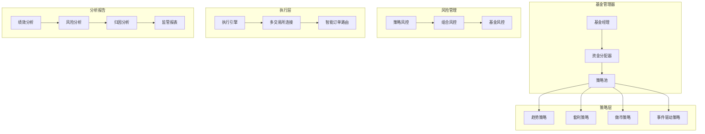

# 第20章：完整项目示例2：多策略量化基金

## 学习目标

- 构建一个多策略的量化交易基金系统
- 实现策略的组合管理和资金分配
- 掌握基金级别的风险控制和管理
- 学会构建完整的量化投资管理系统

## 20.1 项目概述

### 20.1.1 基金架构设计

本项目是一个面向机构投资者的量化交易基金系统，具有以下特点：

- **多策略架构**：支持趋势、套利、做市等多种策略并行运行
- **智能资金分配**：基于风险预算和Kelly准则的动态资金分配
- **多层次风控**：策略级、组合级、基金级三层风险管理
- **绩效归因**：详细的收益归因和风险分析
- **机构级报告**：符合监管要求的报表生成



## 20.2 核心架构实现

### 20.2.1 基金管理器

```python
# src/fund/fund_manager.py
from typing import Dict, List, Optional, Tuple
from dataclasses import dataclass, field
from decimal import Decimal
from datetime import datetime, timedelta
import asyncio
import numpy as np

@dataclass
class StrategyAllocation:
    """策略资金分配"""
    strategy_id: str
    strategy_name: str
    allocated_capital: Decimal
    weight: Decimal  # 分配权重
    target_weight: Decimal  # 目标权重
    min_weight: Decimal    # 最小权重
    max_weight: Decimal    # 最大权重
    risk_budget: Decimal   # 风险预算
    last_rebalance: datetime = field(default_factory=datetime.now)

@dataclass
class FundMetrics:
    """基金指标"""
    total_aum: Decimal  # 管理资产总额
    total_pnl: Decimal  # 总盈亏
    daily_pnl: Decimal  # 日盈亏
    mtd_return: Decimal  # 月初至今收益
    ytd_return: Decimal  # 年初至今收益
    sharpe_ratio: float  # 夏普比率
    max_drawdown: Decimal  # 最大回撤
    var_95: Decimal  # 95% VaR
    total_exposure: Decimal  # 总风险敞口
    leverage: float  # 杠杆倍数

class FundManager:
    """基金管理器"""

    def __init__(self, config: dict):
        self.config = config

        # 基金参数
        self.initial_capital = Decimal(str(config['initial_capital']))
        self.max_leverage = Decimal(str(config.get('max_leverage', '3.0')))
        self.rebalance_frequency = config.get('rebalance_frequency', 'daily')  # daily, weekly, monthly
        self.min_cash_reserve = Decimal(str(config.get('min_cash_reserve', '0.05')))  # 5%现金储备

        # 策略管理
        self.strategies = {}  # {strategy_id: strategy_instance}
        self.allocations = {}  # {strategy_id: StrategyAllocation}
        self.strategy_performance = {}  # {strategy_id: performance_metrics}

        # 资金管理
        self.cash = self.initial_capital
        self.reserved_cash = self.initial_capital * self.min_cash_reserve
        self.available_cash = self.cash - self.reserved_cash

        # 风险管理
        self.risk_manager = FundRiskManager(config.get('risk', {}))
        self.portfolio_optimizer = PortfolioOptimizer(config.get('optimization', {}))

        # 绩效跟踪
        self.performance_tracker = FundPerformanceTracker()
        self.attribution_analyzer = AttributionAnalyzer()

        # 状态
        self.is_running = False
        self.last_rebalance = None

    async def initialize(self):
        """初始化基金"""
        # 初始化策略
        await self._initialize_strategies()

        # 初始资金分配
        await self._initialize_allocations()

        # 启动监控
        asyncio.create_task(self._monitoring_loop())

        self.is_running = True
        self.log.info(f"Fund initialized with AUM: {self.initial_capital}")

    async def _initialize_strategies(self):
        """初始化所有策略"""
        strategy_configs = self.config.get('strategies', {})

        for strategy_id, config in strategy_configs.items():
            strategy = await self._create_strategy(strategy_id, config)
            self.strategies[strategy_id] = strategy

            # 初始化策略性能跟踪
            self.strategy_performance[strategy_id] = {
                'total_pnl': Decimal('0'),
                'daily_pnl': Decimal('0'),
                'positions': {},
                'trades': [],
                'risk_metrics': {}
            }

    async def _create_strategy(self, strategy_id: str, config: dict):
        """创建策略实例"""
        strategy_type = config['type']
        strategy_config = config['config']

        if strategy_type == 'trend_following':
            from src.strategies.trend_following import TrendFollowingStrategy
            strategy = TrendFollowingStrategy(strategy_config)
        elif strategy_type == 'statistical_arbitrage':
            from src.strategies.stat_arb import StatisticalArbitrageStrategy
            strategy = StatisticalArbitrageStrategy(strategy_config)
        elif strategy_type == 'market_making':
            from src.strategies.market_making import MarketMakingStrategy
            strategy = MarketMakingStrategy(strategy_config)
        else:
            raise ValueError(f"Unknown strategy type: {strategy_type}")

        await strategy.initialize()
        return strategy

    async def _initialize_allocations(self):
        """初始化资金分配"""
        strategy_configs = self.config.get('strategies', {})
        total_weight = sum(config.get('weight', 1) for config in strategy_configs.values())

        for strategy_id, config in strategy_configs.items():
            weight = Decimal(str(config.get('weight', 1))) / Decimal(str(total_weight))
            target_weight = Decimal(str(config.get('target_weight', weight)))
            min_weight = Decimal(str(config.get('min_weight', '0')))
            max_weight = Decimal(str(config.get('max_weight', '1')))

            allocated_capital = self.available_cash * weight
            risk_budget = Decimal(str(config.get('risk_budget', '0.02')))  # 默认2%

            allocation = StrategyAllocation(
                strategy_id=strategy_id,
                strategy_name=config.get('name', strategy_id),
                allocated_capital=allocated_capital,
                weight=weight,
                target_weight=target_weight,
                min_weight=min_weight,
                max_weight=max_weight,
                risk_budget=risk_budget
            )

            self.allocations[strategy_id] = allocation

            # 为策略分配资金
            await self._allocate_capital_to_strategy(strategy_id, allocated_capital)

    async def _allocate_capital_to_strategy(self, strategy_id: str, capital: Decimal):
        """为策略分配资金"""
        if strategy_id in self.strategies:
            strategy = self.strategies[strategy_id]
            await strategy.set_capital(capital)
            self.log.info(f"Allocated {capital} to strategy {strategy_id}")

    async def start_trading(self):
        """开始交易"""
        if not self.is_running:
            raise RuntimeError("Fund not initialized")

        # 启动所有策略
        for strategy_id, strategy in self.strategies.items():
            await strategy.start()
            self.log.info(f"Started strategy: {strategy_id}")

        # 启动再平衡任务
        asyncio.create_task(self._rebalance_loop())

        self.log.info("Fund trading started")

    async def stop_trading(self):
        """停止交易"""
        # 停止所有策略
        for strategy_id, strategy in self.strategies.items():
            await strategy.stop()
            self.log.info(f"Stopped strategy: {strategy_id}")

        self.is_running = False
        self.log.info("Fund trading stopped")

    async def _rebalance_loop(self):
        """再平衡循环"""
        while self.is_running:
            try:
                # 检查是否需要再平衡
                if self._should_rebalance():
                    await self._perform_rebalance()

                # 等待下次检查
                if self.rebalance_frequency == 'daily':
                    await asyncio.sleep(3600)  # 每小时检查
                elif self.rebalance_frequency == 'weekly':
                    await asyncio.sleep(3600 * 6)  # 每6小时检查
                else:  # monthly
                    await asyncio.sleep(3600 * 24)  # 每天检查

            except Exception as e:
                self.log.error(f"Rebalance error: {e}")
                await asyncio.sleep(300)  # 5分钟后重试

    def _should_rebalance(self) -> bool:
        """判断是否需要再平衡"""
        now = datetime.now()

        # 检查是否到了再平衡时间
        if self.last_rebalance is None:
            return True

        if self.rebalance_frequency == 'daily':
            # 每天收盘后
            return now.hour >= 16 and now.date() != self.last_rebalance.date()
        elif self.rebalance_frequency == 'weekly':
            # 每周五收盘后
            return now.weekday() == 4 and now.hour >= 16 and now.date() != self.last_rebalance.date()
        elif self.rebalance_frequency == 'monthly':
            # 每月最后一个交易日
            return now.day >= 28 and now.date() != self.last_rebalance.date()

        return False

    async def _perform_rebalance(self):
        """执行再平衡"""
        self.log.info("Starting portfolio rebalance...")

        # 计算最优权重
        optimal_weights = await self._calculate_optimal_weights()

        # 计算当前权重
        current_weights = self._calculate_current_weights()

        # 生成再平衡交易
        rebalance_trades = self._generate_rebalance_trades(current_weights, optimal_weights)

        # 风险检查
        if await self.risk_manager.validate_rebalance(rebalance_trades):
            # 执行再平衡
            await self._execute_rebalance_trades(rebalance_trades)
            self.last_rebalance = datetime.now()
            self.log.info("Rebalance completed successfully")
        else:
            self.log.warning("Rebalance failed risk validation")

    async def _calculate_optimal_weights(self) -> Dict[str, Decimal]:
        """计算最优权重"""
        # 获取策略预期收益和风险
        expected_returns = {}
        covariance_matrix = {}

        for strategy_id in self.strategies.keys():
            perf = self.strategy_performance[strategy_id]
            # 使用历史收益计算预期收益
            returns = self._calculate_strategy_returns(strategy_id)
            expected_returns[strategy_id] = np.mean(returns) if returns else 0.01

        # 构建协方差矩阵
        for id1 in self.strategies.keys():
            covariance_matrix[id1] = {}
            for id2 in self.strategies.keys():
                covariance_matrix[id1][id2] = self._calculate_covariance(id1, id2)

        # 使用均值-方差优化
        return self.portfolio_optimizer.optimize(
            expected_returns=expected_returns,
            covariance_matrix=covariance_matrix,
            constraints={
                'sum_to_one': True,
                'long_only': True,
                'min_weights': {sid: self.allocations[sid].min_weight for sid in self.strategies.keys()},
                'max_weights': {sid: self.allocations[sid].max_weight for sid in self.strategies.keys()}
            }
        )

    def _calculate_current_weights(self) -> Dict[str, Decimal]:
        """计算当前权重"""
        current_values = {}
        total_value = self.get_total_aum()

        for strategy_id in self.strategies.keys():
            strategy_value = self._get_strategy_value(strategy_id)
            current_weights[strategy_id] = strategy_value / total_value if total_value > 0 else Decimal('0')

        return current_weights

    def _generate_rebalance_trades(self, current_weights: Dict[str, Decimal],
                                   target_weights: Dict[str, Decimal]) -> List[dict]:
        """生成再平衡交易"""
        trades = []
        total_value = self.get_total_aum()

        for strategy_id in self.strategies.keys():
            current_weight = current_weights.get(strategy_id, Decimal('0'))
            target_weight = target_weights.get(strategy_id, Decimal('0'))

            # 计算权重差异
            weight_diff = target_weight - current_weight

            # 如果差异超过阈值（0.5%），生成交易
            if abs(weight_diff) > Decimal('0.005'):
                trade_value = total_value * weight_diff
                trades.append({
                    'strategy_id': strategy_id,
                    'action': 'allocate' if weight_diff > 0 else 'deallocate',
                    'value': abs(trade_value),
                    'weight_diff': weight_diff
                })

        return trades

    async def _execute_rebalance_trades(self, trades: List[dict]):
        """执行再平衡交易"""
        for trade in trades:
            strategy_id = trade['strategy_id']
            strategy = self.strategies[strategy_id]

            if trade['action'] == 'allocate':
                # 增加资金
                await strategy.add_capital(trade['value'])
            else:
                # 减少资金
                await strategy.reduce_capital(trade['value'])

    def get_total_aum(self) -> Decimal:
        """获取总管理资产"""
        total = self.cash  # 现金

        # 加上所有策略的价值
        for strategy_id in self.strategies.keys():
            total += self._get_strategy_value(strategy_id)

        return total

    def _get_strategy_value(self, strategy_id: str) -> Decimal:
        """获取策略价值"""
        if strategy_id in self.strategies:
            return self.strategies[strategy_id].get_portfolio_value()
        return Decimal('0')

    def get_fund_metrics(self) -> FundMetrics:
        """获取基金指标"""
        total_aum = self.get_total_aum()

        # 计算收益
        total_pnl = total_aum - self.initial_capital
        daily_pnl = self._calculate_daily_pnl()

        # 计算收益指标
        mtd_return = self._calculate_mtd_return()
        ytd_return = self._calculate_ytd_return()

        # 计算风险指标
        returns = self._calculate_fund_returns()
        sharpe_ratio = self._calculate_sharpe_ratio(returns)
        max_drawdown = self._calculate_max_drawdown()
        var_95 = self._calculate_var(returns, 0.05)

        # 计算敞口和杠杆
        total_exposure = self._calculate_total_exposure()
        leverage = float(total_exposure / total_aum) if total_aum > 0 else 1.0

        return FundMetrics(
            total_aum=total_aum,
            total_pnl=total_pnl,
            daily_pnl=daily_pnl,
            mtd_return=mtd_return,
            ytd_return=ytd_return,
            sharpe_ratio=sharpe_ratio,
            max_drawdown=max_drawdown,
            var_95=var_95,
            total_exposure=total_exposure,
            leverage=leverage
        )

    def get_strategy_performance(self) -> Dict[str, dict]:
        """获取所有策略的绩效"""
        performance = {}

        for strategy_id in self.strategies.keys():
            strategy_perf = self.strategy_performance[strategy_id]
            strategy = self.strategies[strategy_id]

            performance[strategy_id] = {
                'name': self.allocations[strategy_id].strategy_name,
                'allocated_capital': float(self.allocations[strategy_id].allocated_capital),
                'current_weight': float(self._get_strategy_value(strategy_id) / self.get_total_aum()),
                'target_weight': float(self.allocations[strategy_id].target_weight),
                'total_pnl': float(strategy_perf['total_pnl']),
                'daily_pnl': float(strategy_perf['daily_pnl']),
                'sharpe_ratio': strategy.get_sharpe_ratio(),
                'max_drawdown': strategy.get_max_drawdown(),
                'position_count': len(strategy.get_positions()),
                'trade_count': len(strategy_perf['trades'])
            }

        return performance

    async def _monitoring_loop(self):
        """监控循环"""
        while self.is_running:
            try:
                # 更新绩效指标
                await self._update_performance_metrics()

                # 风险监控
                await self.risk_manager.monitor_risk(self)

                # 生成报告（每小时）
                if datetime.now().minute == 0:
                    await self._generate_hourly_report()

                await asyncio.sleep(60)  # 每分钟更新

            except Exception as e:
                self.log.error(f"Monitoring error: {e}")
                await asyncio.sleep(60)

    async def _update_performance_metrics(self):
        """更新绩效指标"""
        for strategy_id, strategy in self.strategies.items():
            # 更新策略绩效
            perf = self.strategy_performance[strategy_id]
            perf['total_pnl'] = Decimal(str(strategy.get_total_pnl()))
            perf['daily_pnl'] = Decimal(str(strategy.get_daily_pnl()))
            perf['positions'] = strategy.get_positions()
            perf['risk_metrics'] = strategy.get_risk_metrics()

    async def _generate_hourly_report(self):
        """生成小时报告"""
        fund_metrics = self.get_fund_metrics()
        strategy_perf = self.get_strategy_performance()

        report = {
            'timestamp': datetime.now().isoformat(),
            'fund_metrics': {
                'total_aum': float(fund_metrics.total_aum),
                'total_pnl': float(fund_metrics.total_pnl),
                'daily_pnl': float(fund_metrics.daily_pnl),
                'leverage': fund_metrics.leverage,
                'max_drawdown': float(fund_metrics.max_drawdown)
            },
            'strategy_performance': strategy_perf
        }

        # 保存报告
        await self._save_report(report, 'hourly')

        # 检查告警条件
        await self._check_alert_conditions(fund_metrics)

    async def _check_alert_conditions(self, metrics: FundMetrics):
        """检查告警条件"""
        # 检查杠杆
        if metrics.leverage > float(self.max_leverage):
            await self._send_alert('HIGH_LEVERAGE', f"Leverage {metrics.leverage:.2f} exceeds limit {self.max_leverage}")

        # 检查回撤
        if metrics.max_drawdown > Decimal('0.1'):  # 10%
            await self._send_alert('HIGH_DRAWDOWN', f"Max drawdown {metrics.max_drawdown:.2%}")

        # 检查日损失
        if metrics.daily_pnl < -self.initial_capital * Decimal('0.02'):  # 2%
            await self._send_alert('LARGE_DAILY_LOSS', f"Daily loss {metrics.daily_pnl:.2f}")

    async def _send_alert(self, alert_type: str, message: str):
        """发送告警"""
        alert = {
            'type': alert_type,
            'message': message,
            'timestamp': datetime.now(),
            'fund_aum': float(self.get_total_aum()),
            'leverage': float(self._calculate_total_exposure() / self.get_total_aum())
        }

        # 这里可以集成各种告警渠道
        self.log.warning(f"ALERT [{alert_type}]: {message}")

    async def _save_report(self, report: dict, report_type: str):
        """保存报告"""
        import json
        from pathlib import Path

        reports_dir = Path('reports')
        reports_dir.mkdir(exist_ok=True)

        timestamp = datetime.now().strftime('%Y%m%d_%H%M%S')
        filename = f"{report_type}_report_{timestamp}.json"
        filepath = reports_dir / filename

        with open(filepath, 'w') as f:
            json.dump(report, f, indent=2)
```

### 20.2.2 投资组合优化器

```python
# src/portfolio/portfolio_optimizer.py
import cvxpy as cp
import numpy as np
from typing import Dict, List, Optional
from decimal import Decimal

class PortfolioOptimizer:
    """投资组合优化器"""

    def __init__(self, config: dict):
        self.config = config
        self.risk_free_rate = config.get('risk_free_rate', 0.02)
        self.optimization_method = config.get('method', 'mean_variance')  # mean_variance, risk_parity, equal_weight

    def optimize(self, expected_returns: Dict[str, float],
                 covariance_matrix: Dict[str, Dict[str, float]],
                 constraints: dict) -> Dict[str, Decimal]:
        """优化投资组合"""
        if self.optimization_method == 'mean_variance':
            return self._mean_variance_optimization(expected_returns, covariance_matrix, constraints)
        elif self.optimization_method == 'risk_parity':
            return self._risk_parity_optimization(covariance_matrix, constraints)
        elif self.optimization_method == 'equal_weight':
            return self._equal_weight_optimization(constraints)
        else:
            raise ValueError(f"Unknown optimization method: {self.optimization_method}")

    def _mean_variance_optimization(self, expected_returns: Dict[str, float],
                                    covariance_matrix: Dict[str, Dict[str, float]],
                                    constraints: dict) -> Dict[str, Decimal]:
        """均值-方差优化"""
        assets = list(expected_returns.keys())
        n = len(assets)

        # 转换为numpy数组
        mu = np.array([expected_returns[asset] for asset in assets])
        Sigma = np.array([[covariance_matrix[asset1][asset2] for asset2 in assets] for asset1 in assets])

        # 优化变量
        w = cp.Variable(n)

        # 目标函数：最大化 夏普比率
        portfolio_return = mu.T @ w
        portfolio_variance = cp.quad_form(w, Sigma)
        objective = cp.Maximize((portfolio_return - self.risk_free_rate) / cp.sqrt(portfolio_variance))

        # 约束条件
        constraints_list = []

        # 权重和为1
        if constraints.get('sum_to_one', True):
            constraints_list.append(cp.sum(w) == 1)

        # 非负权重（不允许做空）
        if constraints.get('long_only', True):
            constraints_list.append(w >= 0)

        # 最小/最大权重
        if 'min_weights' in constraints:
            min_weights = [constraints['min_weights'].get(asset, 0) for asset in assets]
            constraints_list.append(w >= min_weights)

        if 'max_weights' in constraints:
            max_weights = [constraints['max_weights'].get(asset, 1) for asset in assets]
            constraints_list.append(w <= max_weights)

        # 风险预算约束
        if 'risk_budgets' in constraints:
            marginal_contributions = Sigma @ w
            for i, asset in enumerate(assets):
                if asset in constraints['risk_budgets']:
                    constraints_list.append(
                        w[i] * marginal_contributions[i] <= constraints['risk_budgets'][asset]
                    )

        # 求解优化问题
        problem = cp.Problem(objective, constraints_list)
        problem.solve()

        if problem.status not in ["infeasible", "unbounded"]:
            optimal_weights = w.value
            return {asset: Decimal(str(weight)) for asset, weight in zip(assets, optimal_weights)}
        else:
            # 如果优化失败，返回等权重
            return self._equal_weight_optimization(constraints)

    def _risk_parity_optimization(self, covariance_matrix: Dict[str, Dict[str, float]],
                                  constraints: dict) -> Dict[str, Decimal]:
        """风险平价优化"""
        assets = list(covariance_matrix.keys())
        n = len(assets)

        # 转换为numpy数组
        Sigma = np.array([[covariance_matrix[asset1][asset2] for asset2 in assets] for asset1 in assets])

        # 优化变量
        w = cp.Variable(n)

        # 计算投资组合方差和边际风险贡献
        portfolio_variance = cp.quad_form(w, Sigma)
        marginal_contributions = Sigma @ w

        # 目标：最小化风险贡献差异的平方和
        risk_contributions = cp.multiply(w, marginal_contributions)
        avg_risk_contribution = cp.sum(risk_contributions) / n
        objective = cp.Minimize(cp.sum_squares(risk_contributions - avg_risk_contribution))

        # 约束条件
        constraints_list = [
            cp.sum(w) == 1,
            w >= 0
        ]

        # 添加最小/最大权重约束
        if 'min_weights' in constraints:
            min_weights = [constraints['min_weights'].get(asset, 0.01) for asset in assets]
            constraints_list.append(w >= min_weights)

        if 'max_weights' in constraints:
            max_weights = [constraints['max_weights'].get(asset, 0.4) for asset in assets]
            constraints_list.append(w <= max_weights)

        # 求解
        problem = cp.Problem(objective, constraints_list)
        problem.solve()

        if problem.status not in ["infeasible", "unbounded"]:
            optimal_weights = w.value
            return {asset: Decimal(str(weight)) for asset, weight in zip(assets, optimal_weights)}
        else:
            return self._equal_weight_optimization(constraints)

    def _equal_weight_optimization(self, constraints: dict) -> Dict[str, Decimal]:
        """等权重优化"""
        assets = list(constraints.get('min_weights', {}).keys())
        if not assets:
            # 如果没有指定资产列表，返回空字典
            return {}

        n = len(assets)
        equal_weight = Decimal('1') / Decimal(str(n))

        weights = {}
        for asset in assets:
            # 应用最小权重约束
            min_weight = Decimal(str(constraints['min_weights'].get(asset, 0)))
            max_weight = Decimal(str(constraints['max_weights'].get(asset, 1)))

            weight = max(equal_weight, min_weight)
            weight = min(weight, max_weight)
            weights[asset] = weight

        # 重新归一化以确保总和为1
        total_weight = sum(weights.values())
        if total_weight > 0:
            weights = {k: v / total_weight for k, v in weights.items()}

        return weights

    def black_litterman_optimization(self, views: Dict[str, float],
                                     view_uncertainties: Dict[str, float],
                                     tau: float = 0.025,
                                     risk_aversion: float = 3.0) -> Dict[str, Decimal]:
        """Black-Litterman优化"""
        # 这是一个简化的Black-Litterman实现
        # 在实际应用中需要更完整的实现

        # 需要市场隐含收益率和协方差矩阵
        # 这里返回均值-方差优化的结果作为占位符
        return {}

    def robust_optimization(self, expected_returns: Dict[str, float],
                            uncertainty_sets: Dict[str, float],
                            covariance_matrix: Dict[str, Dict[str, float]],
                            constraints: dict) -> Dict[str, Decimal]:
        """鲁棒优化（最坏情况优化）"""
        # 考虑预期收益的不确定性
        adjusted_returns = {}
        for asset, exp_ret in expected_returns.items():
            uncertainty = uncertainty_sets.get(asset, 0.01)
            # 使用最坏情况下的收益
            adjusted_returns[asset] = exp_ret - uncertainty

        return self._mean_variance_optimization(adjusted_returns, covariance_matrix, constraints)
```

## 20.3 高级风险管理

### 20.3.1 多层次风险控制

```python
# src/risk/fund_risk_manager.py
from typing import Dict, List, Optional, Tuple
from dataclasses import dataclass
from decimal import Decimal
import numpy as np
from datetime import datetime

@dataclass
class RiskLimit:
    """风险限制"""
    name: str
    limit_type: str  # position, leverage, var, drawdown, concentration
    limit_value: Decimal
    current_value: Decimal
    utilization: Decimal  # current/limit
    breach_count: int = 0
    last_breach: Optional[datetime] = None

@dataclass
class StressTestResult:
    """压力测试结果"""
    scenario_name: str
    portfolio_pnl: Decimal
    max_loss: Decimal
    var_estimate: Decimal
    worst_drawdown: Decimal
    breaching_positions: List[str]

class FundRiskManager:
    """基金风险管理器"""

    def __init__(self, config: dict):
        self.config = config

        # 风险限制
        self.limits = self._initialize_limits()

        # 压力测试场景
        self.stress_scenarios = self._initialize_stress_scenarios()

        # 风险监控
        self.risk_monitoring_active = True
        self.last_risk_check = None

    def _initialize_limits(self) -> Dict[str, RiskLimit]:
        """初始化风险限制"""
        limits_config = self.config.get('limits', {})
        limits = {}

        # 仓位限制
        limits['max_position'] = RiskLimit(
            name='max_position',
            limit_type='position',
            limit_value=Decimal(str(limits_config.get('max_position', '0.2'))),  # 单个策略最大20%
            current_value=Decimal('0'),
            utilization=Decimal('0')
        )

        # 杠杆限制
        limits['max_leverage'] = RiskLimit(
            name='max_leverage',
            limit_type='leverage',
            limit_value=Decimal(str(limits_config.get('max_leverage', '3.0'))),
            current_value=Decimal('0'),
            utilization=Decimal('0')
        )

        # VaR限制
        limits['max_var'] = RiskLimit(
            name='max_var',
            limit_type='var',
            limit_value=Decimal(str(limits_config.get('max_var', '0.02'))),  # 2% VaR
            current_value=Decimal('0'),
            utilization=Decimal('0')
        )

        # 回撤限制
        limits['max_drawdown'] = RiskLimit(
            name='max_drawdown',
            limit_type='drawdown',
            limit_value=Decimal(str(limits_config.get('max_drawdown', '0.15'))),  # 15%
            current_value=Decimal('0'),
            utilization=Decimal('0')
        )

        # 集中度限制
        limits['max_concentration'] = RiskLimit(
            name='max_concentration',
            limit_type='concentration',
            limit_value=Decimal(str(limits_config.get('max_concentration', '0.4'))),  # 40%
            current_value=Decimal('0'),
            utilization=Decimal('0')
        )

        return limits

    def _initialize_stress_scenarios(self) -> List[dict]:
        """初始化压力测试场景"""
        scenarios_config = self.config.get('stress_scenarios', [])
        scenarios = []

        # 默认场景
        default_scenarios = [
            {
                'name': 'market_crash',
                'shocks': {
                    'equity': -0.30,  # 股市下跌30%
                    'volatility': 2.0,  # 波动率翻倍
                    'correlation': 0.8   # 相关性上升到0.8
                }
            },
            {
                'name': 'volatility_spike',
                'shocks': {
                    'volatility': 3.0,  # 波动率上升3倍
                    'correlation': 0.9   # 相关性上升到0.9
                }
            },
            {
                'name': 'liquidity_crisis',
                'shocks': {
                    'bid_ask_spread': 5.0,  # 买卖价差扩大5倍
                    'market_impact': 2.0    # 市场冲击增加2倍
                }
            }
        ]

        # 添加配置的场景
        scenarios.extend(default_scenarios)
        scenarios.extend(scenarios_config)

        return scenarios

    async def monitor_risk(self, fund_manager):
        """监控风险"""
        if not self.risk_monitoring_active:
            return

        try:
            # 检查所有风险限制
            await self._check_all_limits(fund_manager)

            # 执行压力测试
            await self._run_stress_tests(fund_manager)

            # 更新风险报告
            await self._update_risk_report(fund_manager)

            self.last_risk_check = datetime.now()

        except Exception as e:
            fund_manager.log.error(f"Risk monitoring error: {e}")

    async def _check_all_limits(self, fund_manager):
        """检查所有风险限制"""
        # 检查仓位限制
        await self._check_position_limits(fund_manager)

        # 检查杠杆限制
        await self._check_leverage_limits(fund_manager)

        # 检查VaR限制
        await self._check_var_limits(fund_manager)

        # 检查回撤限制
        await self._check_drawdown_limits(fund_manager)

        # 检查集中度限制
        await self._check_concentration_limits(fund_manager)

    async def _check_position_limits(self, fund_manager):
        """检查仓位限制"""
        total_aum = fund_manager.get_total_aum()
        strategy_performance = fund_manager.get_strategy_performance()

        for strategy_id, perf in strategy_performance.items():
            strategy_value = Decimal(str(perf['allocated_capital'])) + Decimal(str(perf['total_pnl']))
            position_ratio = strategy_value / total_aum if total_aum > 0 else Decimal('0')

            limit = self.limits['max_position']
            limit.current_value = position_ratio
            limit.utilization = position_ratio / limit.limit_value if limit.limit_value > 0 else Decimal('0')

            if position_ratio > limit.limit_value:
                limit.breach_count += 1
                limit.last_breach = datetime.now()

                await self._handle_limit_breach(limit, {
                    'strategy_id': strategy_id,
                    'position_ratio': float(position_ratio),
                    'limit': float(limit.limit_value)
                })

    async def _check_leverage_limits(self, fund_manager):
        """检查杠杆限制"""
        total_exposure = self._calculate_total_exposure(fund_manager)
        total_aum = fund_manager.get_total_aum()
        leverage = total_exposure / total_aum if total_aum > 0 else Decimal('0')

        limit = self.limits['max_leverage']
        limit.current_value = leverage
        limit.utilization = leverage / limit.limit_value if limit.limit_value > 0 else Decimal('0')

        if leverage > limit.limit_value:
            limit.breach_count += 1
            limit.last_breach = datetime.now()

            await self._handle_limit_breach(limit, {
                'current_leverage': float(leverage),
                'limit': float(limit.limit_value)
            })

    async def _check_var_limits(self, fund_manager):
        """检查VaR限制"""
        # 计算投资组合VaR
        returns = self._calculate_portfolio_returns(fund_manager)
        var_95 = self._calculate_var(returns, 0.05)

        limit = self.limits['max_var']
        limit.current_value = var_95
        limit.utilization = var_95 / limit.limit_value if limit.limit_value > 0 else Decimal('0')

        if var_95 > limit.limit_value:
            limit.breach_count += 1
            limit.last_breach = datetime.now()

            await self._handle_limit_breach(limit, {
                'var_95': float(var_95),
                'limit': float(limit.limit_value)
            })

    async def _check_drawdown_limits(self, fund_manager):
        """检查回撤限制"""
        max_drawdown = self._calculate_max_drawdown(fund_manager)

        limit = self.limits['max_drawdown']
        limit.current_value = max_drawdown
        limit.utilization = max_drawdown / limit.limit_value if limit.limit_value > 0 else Decimal('0')

        if max_drawdown > limit.limit_value:
            limit.breach_count += 1
            limit.last_breach = datetime.now()

            await self._handle_limit_breach(limit, {
                'max_drawdown': float(max_drawdown),
                'limit': float(limit.limit_value)
            })

    async def _check_concentration_limits(self, fund_manager):
        """检查集中度限制"""
        # 计算资产集中度（Herfindahl指数）
        strategy_performance = fund_manager.get_strategy_performance()
        weights = [Decimal(str(p['current_weight'])) for p in strategy_performance.values()]
        herfindahl = sum(w**2 for w in weights)

        limit = self.limits['max_concentration']
        limit.current_value = herfindahl
        limit.utilization = herfindahl / limit.limit_value if limit.limit_value > 0 else Decimal('0')

        if herfindahl > limit.limit_value:
            limit.breach_count += 1
            limit.last_breach = datetime.now()

            await self._handle_limit_breach(limit, {
                'herfindahl_index': float(herfindahl),
                'limit': float(limit.limit_value)
            })

    async def _handle_limit_breach(self, limit: RiskLimit, details: dict):
        """处理风险限制突破"""
        breach_level = self._determine_breach_level(limit)

        if breach_level == 'critical':
            # 严重突破：立即采取措施
            await self._handle_critical_breach(limit, details)
        elif breach_level == 'warning':
            # 警告级别：记录并监控
            await self._handle_warning_breach(limit, details)

    def _determine_breach_level(self, limit: RiskLimit) -> str:
        """确定突破级别"""
        if limit.utilization > Decimal('1.5'):  # 超过50%
            return 'critical'
        elif limit.utilization > Decimal('1.0'):  # 超过限制
            return 'warning'
        elif limit.utilization > Decimal('0.8'):  # 接近限制
            return 'info'
        else:
            return 'normal'

    async def _handle_critical_breach(self, limit: RiskLimit, details: dict):
        """处理严重突破"""
        # 触发紧急措施
        if limit.limit_type == 'leverage':
            await self._emergency_deleverage()
        elif limit.limit_type == 'var':
            await self._reduce_risk_exposure()
        elif limit.limit_type == 'drawdown':
            await self._emergency_stop_loss()

    async def _handle_warning_breach(self, limit: RiskLimit, details: dict):
        """处理警告级别突破"""
        # 记录并可能通知
        pass

    async def _run_stress_tests(self, fund_manager):
        """运行压力测试"""
        stress_results = {}

        for scenario in self.stress_scenarios:
            result = await self._run_single_stress_test(fund_manager, scenario)
            stress_results[scenario['name']] = result

        # 检查压力测试结果
        for scenario_name, result in stress_results.items():
            if result.max_loss < -self.limits['max_var'].limit_value:
                await self._handle_stress_test_failure(scenario_name, result)

        return stress_results

    async def _run_single_stress_test(self, fund_manager, scenario: dict) -> StressTestResult:
        """运行单个压力测试"""
        # 获取当前持仓
        positions = self._get_all_positions(fund_manager)

        # 应用冲击
        shocked_returns = {}
        for asset in positions.keys():
            # 根据资产类型应用不同的冲击
            if 'equity' in asset.lower():
                shocked_returns[asset] = scenario['shocks'].get('equity', 0)
            elif 'bond' in asset.lower():
                shocked_returns[asset] = scenario['shocks'].get('bond', 0)
            else:
                shocked_returns[asset] = 0

        # 计算投资组合PnL
        portfolio_pnl = Decimal('0')
        for asset, position in positions.items():
            pnl = position * Decimal(str(shocked_returns.get(asset, 0)))
            portfolio_pnl += pnl

        # 计算最大损失
        max_loss = min(portfolio_pnl, Decimal('0'))

        # 估算压力VaR
        var_estimate = abs(max_loss)

        # 计算最差回撤
        worst_drawdown = abs(max_loss) / fund_manager.get_total_aum()

        # 找出突破限制的持仓
        breaching_positions = []
        for asset, position in positions.items():
            if abs(position * Decimal(str(shocked_returns.get(asset, 0)))) > fund_manager.get_total_aum() * Decimal('0.01'):
                breaching_positions.append(asset)

        return StressTestResult(
            scenario_name=scenario['name'],
            portfolio_pnl=portfolio_pnl,
            max_loss=max_loss,
            var_estimate=var_estimate,
            worst_drawdown=worst_drawdown,
            breaching_positions=breaching_positions
        )

    async def _handle_stress_test_failure(self, scenario_name: str, result: StressTestResult):
        """处理压力测试失败"""
        # 记录失败
        # 可能需要调整风险参数
        pass

    def calculate_risk_metrics(self, fund_manager) -> dict:
        """计算风险指标"""
        returns = self._calculate_portfolio_returns(fund_manager)

        return {
            'volatility': self._calculate_volatility(returns),
            'var_95': self._calculate_var(returns, 0.05),
            'var_99': self._calculate_var(returns, 0.01),
            'cvar_95': self._calculate_cvar(returns, 0.05),
            'max_drawdown': self._calculate_max_drawdown(fund_manager),
            'sharpe_ratio': self._calculate_sharpe_ratio(returns),
            'sortino_ratio': self._calculate_sortino_ratio(returns),
            'calmar_ratio': self._calculate_calmar_ratio(fund_manager),
            'information_ratio': self._calculate_information_ratio(fund_manager),
            'beta': self._calculate_beta(fund_manager),
            'tracking_error': self._calculate_tracking_error(fund_manager)
        }

    def _calculate_volatility(self, returns: List[float]) -> float:
        """计算波动率"""
        if len(returns) < 2:
            return 0.0
        return np.std(returns) * np.sqrt(252)  # 年化波动率

    def _calculate_var(self, returns: List[float], alpha: float) -> Decimal:
        """计算VaR"""
        if len(returns) < 10:
            return Decimal('0')
        var = np.percentile(returns, alpha * 100)
        return Decimal(str(var))

    def _calculate_cvar(self, returns: List[float], alpha: float) -> Decimal:
        """计算条件VaR"""
        if len(returns) < 10:
            return Decimal('0')
        var = np.percentile(returns, alpha * 100)
        cvar = np.mean([r for r in returns if r <= var])
        return Decimal(str(cvar))

    def _calculate_max_drawdown(self, fund_manager) -> Decimal:
        """计算最大回撤"""
        # 需要历史净值数据
        # 这里返回占位符
        return Decimal('0.05')  # 示例：5%

    def _calculate_sharpe_ratio(self, returns: List[float]) -> float:
        """计算夏普比率"""
        if len(returns) < 2:
            return 0.0
        excess_return = np.mean(returns) - self.config.get('risk_free_rate', 0.02)
        volatility = self._calculate_volatility(returns)
        return excess_return / volatility if volatility > 0 else 0.0

    def _calculate_sortino_ratio(self, returns: List[float]) -> float:
        """计算Sortino比率"""
        if len(returns) < 2:
            return 0.0
        downside_returns = [r for r in returns if r < 0]
        if not downside_returns:
            return float('inf')
        excess_return = np.mean(returns) - self.config.get('risk_free_rate', 0.02)
        downside_volatility = np.std(downside_returns)
        return excess_return / downside_volatility if downside_volatility > 0 else 0.0

    # 其他辅助方法...
    def _get_all_positions(self, fund_manager) -> Dict[str, Decimal]:
        """获取所有持仓"""
        positions = {}
        for strategy_id, strategy in fund_manager.strategies.items():
            strategy_positions = strategy.get_positions()
            for asset, position in strategy_positions.items():
                positions[asset] = positions.get(asset, Decimal('0')) + Decimal(str(position))
        return positions

    def _calculate_total_exposure(self, fund_manager) -> Decimal:
        """计算总风险敞口"""
        total_exposure = Decimal('0')
        for strategy in fund_manager.strategies.values():
            total_exposure += strategy.get_exposure()
        return total_exposure

    def _calculate_portfolio_returns(self, fund_manager) -> List[float]:
        """计算投资组合收益率"""
        # 需要历史数据
        # 这里返回示例数据
        return [0.001, -0.002, 0.003, -0.001, 0.002]

    async def validate_rebalance(self, trades: List[dict]) -> bool:
        """验证再平衡交易"""
        # 检查交易是否符合风险限制
        for trade in trades:
            if not await self._validate_trade(trade):
                return False
        return True

    async def _validate_trade(self, trade: dict) -> bool:
        """验证单个交易"""
        # 检查交易规模、集中度等
        return True

    # 紧急措施方法
    async def _emergency_deleverage(self):
        """紧急去杠杆"""
        self.log.critical("Emergency deleveraging triggered!")
        # 实现紧急去杠杆逻辑

    async def _reduce_risk_exposure(self):
        """降低风险敞口"""
        self.log.warning("Reducing risk exposure...")
        # 实现风险敞口降低逻辑

    async def _emergency_stop_loss(self):
        """紧急止损"""
        self.log.critical("Emergency stop loss triggered!")
        # 实现紧急止损逻辑
```

## 20.4 绩效归因系统

### 20.4.1 收益归因分析

```python
# src/attribution/attribution_analyzer.py
from typing import Dict, List, Tuple
from dataclasses import dataclass
from decimal import Decimal
import numpy as np
from datetime import datetime, timedelta

@dataclass
class AttributionResult:
    """归因结果"""
    total_return: Decimal
    benchmark_return: Decimal
    active_return: Decimal  # 超额收益
    allocation_effect: Decimal  # 配置效应
    selection_effect: Decimal  # 选股效应
    interaction_effect: Decimal  # 交互效应
    trading_cost: Decimal  # 交易成本
    currency_effect: Decimal  # 汇率效应

@dataclass
class FactorAttribution:
    """因子归因"""
    factor_name: str
    factor_return: Decimal
    factor_exposure: Decimal
    factor_contribution: Decimal

class AttributionAnalyzer:
    """绩效归因分析器"""

    def __init__(self, config: dict):
        self.config = config
        self.benchmark = config.get('benchmark', 'SPY')
        self.factors = config.get('factors', [
            'momentum',
            'value',
            'size',
            'quality',
            'volatility',
            'liquidity'
        ])

    def calculate_attribution(self, portfolio_returns: Dict[str, float],
                             benchmark_returns: Dict[str, float],
                             portfolio_weights: Dict[str, float],
                             benchmark_weights: Dict[str, float],
                             period: str = 'monthly') -> AttributionResult:
        """计算绩效归因"""
        # 计算总收益
        total_return = self._calculate_portfolio_return(portfolio_returns, portfolio_weights)
        benchmark_return = self._calculate_portfolio_return(benchmark_returns, benchmark_weights)
        active_return = total_return - benchmark_return

        # 计算效应分解（Brinson模型）
        allocation_effect = self._calculate_allocation_effect(
            portfolio_returns, benchmark_returns,
            portfolio_weights, benchmark_weights
        )

        selection_effect = self._calculate_selection_effect(
            portfolio_returns, benchmark_returns,
            portfolio_weights, benchmark_weights
        )

        interaction_effect = self._calculate_interaction_effect(
            portfolio_returns, benchmark_returns,
            portfolio_weights, benchmark_weights
        )

        # 其他效应
        trading_cost = self._estimate_trading_cost()
        currency_effect = self._estimate_currency_effect()

        return AttributionResult(
            total_return=total_return,
            benchmark_return=benchmark_return,
            active_return=active_return,
            allocation_effect=allocation_effect,
            selection_effect=selection_effect,
            interaction_effect=interaction_effect,
            trading_cost=trading_cost,
            currency_effect=currency_effect
        )

    def _calculate_portfolio_return(self, returns: Dict[str, float], weights: Dict[str, float]) -> Decimal:
        """计算投资组合收益"""
        portfolio_return = 0.0
        total_weight = sum(weights.values())

        for asset, weight in weights.items():
            if asset in returns:
                portfolio_return += weight * returns[asset] / total_weight

        return Decimal(str(portfolio_return))

    def _calculate_allocation_effect(self, portfolio_returns: Dict[str, float],
                                   benchmark_returns: Dict[str, float],
                                   portfolio_weights: Dict[str, float],
                                   benchmark_weights: Dict[str, float]) -> Decimal:
        """计算配置效应"""
        allocation_effect = 0.0

        for asset in portfolio_weights.keys():
            if asset in benchmark_weights:
                # 超额权重 × 基准收益
                weight_diff = portfolio_weights[asset] - benchmark_weights[asset]
                benchmark_return = benchmark_returns.get(asset, 0)
                allocation_effect += weight_diff * benchmark_return

        return Decimal(str(allocation_effect))

    def _calculate_selection_effect(self, portfolio_returns: Dict[str, float],
                                   benchmark_returns: Dict[str, float],
                                   portfolio_weights: Dict[str, float],
                                   benchmark_weights: Dict[str, float]) -> Decimal:
        """计算选股效应"""
        selection_effect = 0.0

        for asset in portfolio_weights.keys():
            if asset in benchmark_weights:
                # 基准权重 × 超额收益
                weight = benchmark_weights[asset]
                excess_return = portfolio_returns.get(asset, 0) - benchmark_returns.get(asset, 0)
                selection_effect += weight * excess_return

        return Decimal(str(selection_effect))

    def _calculate_interaction_effect(self, portfolio_returns: Dict[str, float],
                                     benchmark_returns: Dict[str, float],
                                     portfolio_weights: Dict[str, float],
                                     benchmark_weights: Dict[str, float]) -> Decimal:
        """计算交互效应"""
        interaction_effect = 0.0

        for asset in portfolio_weights.keys():
            if asset in benchmark_weights:
                # 超额权重 × 超额收益
                weight_diff = portfolio_weights[asset] - benchmark_weights[asset]
                excess_return = portfolio_returns.get(asset, 0) - benchmark_returns.get(asset, 0)
                interaction_effect += weight_diff * excess_return

        return Decimal(str(interaction_effect))

    def calculate_factor_attribution(self, portfolio: Dict,
                                    factor_returns: Dict[str, float],
                                    factor_loadings: Dict[str, Dict[str, float]]) -> List[FactorAttribution]:
        """计算因子归因"""
        attributions = []

        for factor in self.factors:
            if factor in factor_returns:
                factor_return = factor_returns[factor]

                # 计算组合在该因子上的平均暴露
                portfolio_exposure = self._calculate_average_factor_exposure(
                    portfolio, factor_loadings.get(factor, {})
                )

                # 计算因子贡献
                factor_contribution = factor_return * portfolio_exposure

                attributions.append(FactorAttribution(
                    factor_name=factor,
                    factor_return=Decimal(str(factor_return)),
                    factor_exposure=Decimal(str(portfolio_exposure)),
                    factor_contribution=Decimal(str(factor_contribution))
                ))

        return attributions

    def _calculate_average_factor_exposure(self, portfolio: Dict,
                                           factor_loadings: Dict[str, float]) -> float:
        """计算平均因子暴露"""
        total_exposure = 0.0
        total_weight = 0.0

        for asset, weight in portfolio.items():
            exposure = factor_loadings.get(asset, 0)
            total_exposure += weight * exposure
            total_weight += weight

        return total_exposure / total_weight if total_weight > 0 else 0.0

    def generate_attribution_report(self, attribution: AttributionResult,
                                  factor_attributions: List[FactorAttribution] = None) -> dict:
        """生成归因报告"""
        report = {
            'period': datetime.now().strftime('%Y-%m'),
            'total_return': float(attribution.total_return),
            'benchmark_return': float(attribution.benchmark_return),
            'active_return': float(attribution.active_return),
            'attribution_breakdown': {
                'allocation_effect': float(attribution.allocation_effect),
                'selection_effect': float(attribution.selection_effect),
                'interaction_effect': float(attribution.interaction_effect),
                'trading_cost': float(attribution.trading_cost),
                'currency_effect': float(attribution.currency_effect)
            },
            'attribution_percentages': {}
        }

        # 计算各项贡献占比
        if attribution.active_return != 0:
            report['attribution_percentages'] = {
                'allocation': float(attribution.allocation_effect / attribution.active_return * 100),
                'selection': float(attribution.selection_effect / attribution.active_return * 100),
                'interaction': float(attribution.interaction_effect / attribution.active_return * 100),
                'costs': float(attribution.trading_cost / attribution.active_return * 100)
            }

        # 添加因子归因
        if factor_attributions:
            report['factor_attribution'] = {
                factor.name: {
                    'return': float(factor.factor_return),
                    'exposure': float(factor.factor_exposure),
                    'contribution': float(factor.factor_contribution)
                }
                for factor in factor_attributions
            }

        return report

    def rolling_attribution_analysis(self, returns_history: Dict[str, List[Tuple[datetime, float]]],
                                    weights_history: Dict[str, List[Tuple[datetime, float]]],
                                    window: int = 12) -> Dict[str, List[dict]]:
        """滚动归因分析"""
        rolling_results = {}

        for asset in returns_history.keys():
            asset_returns = returns_history[asset]
            asset_weights = weights_history.get(asset, [])

            if len(asset_returns) < window:
                continue

            rolling_attributions = []
            for i in range(len(asset_returns) - window + 1):
                window_returns = {asset: r for (_, r) in asset_returns[i:i+window]}
                window_weights = {asset: w for (_, w) in asset_weights[i:i+window]}

                # 计算窗口期归因
                # 这里需要简化实现
                attribution = AttributionResult(
                    total_return=Decimal('0'),
                    benchmark_return=Decimal('0'),
                    active_return=Decimal('0'),
                    allocation_effect=Decimal('0'),
                    selection_effect=Decimal('0'),
                    interaction_effect=Decimal('0'),
                    trading_cost=Decimal('0'),
                    currency_effect=Decimal('0')
                )

                rolling_attributions.append({
                    'end_date': asset_returns[i + window - 1][0],
                    'attribution': self.generate_attribution_report(attribution)
                })

            rolling_results[asset] = rolling_attributions

        return rolling_results

    def _estimate_trading_cost(self) -> Decimal:
        """估算交易成本"""
        # 基于交易量和市场条件估算
        return Decimal('0.001')  # 示例：10个基点

    def _estimate_currency_effect(self) -> Decimal:
        """估算汇率效应"""
        # 对于多货币投资组合
        return Decimal('0')  # 示例值

    def analyze_style_attribution(self, portfolio_positions: Dict,
                                 style_factors: Dict[str, Dict[str, float]]) -> dict:
        """分析风格归因"""
        style_analysis = {}

        # 计算投资组合在各个风格因子上的暴露
        portfolio_exposures = {}
        for style, loadings in style_factors.items():
            exposure = self._calculate_style_exposure(portfolio_positions, loadings)
            portfolio_exposures[style] = exposure

        # 计算风格收益贡献
        style_returns = {
            'value': 0.015,      # 价值因子收益
            'growth': 0.010,     # 成长因子收益
            'momentum': 0.020,   # 动量因子收益
            'quality': 0.008,    # 质量因子收益
            'size': 0.005        # 规模因子收益
        }

        style_contributions = {}
        for style, exposure in portfolio_exposures.items():
            if style in style_returns:
                contribution = exposure * style_returns[style]
                style_contributions[style] = contribution

        style_analysis = {
            'exposures': {k: float(v) for k, v in portfolio_exposures.items()},
            'returns': style_returns,
            'contributions': {k: float(v) for k, v in style_contributions.items()},
            'total_contribution': float(sum(style_contributions.values()))
        }

        return style_analysis

    def _calculate_style_exposure(self, positions: Dict, loadings: Dict[str, float]) -> float:
        """计算风格暴露"""
        total_exposure = 0.0
        total_weight = 0.0

        for asset, weight in positions.items():
            loading = loadings.get(asset, 0)
            total_exposure += weight * loading
            total_weight += abs(weight)

        return total_exposure / total_weight if total_weight > 0 else 0.0
```

## 20.5 主程序实现

### 20.5.1 基金主程序

```python
# src/main_fund.py
import asyncio
import signal
import sys
import logging
from pathlib import Path
from datetime import datetime

from src.config.config_manager import ConfigManager
from src.fund.fund_manager import FundManager
from src.risk.fund_risk_manager import FundRiskManager
from src.attribution.attribution_analyzer import AttributionAnalyzer
from src.reporting.fund_reporter import FundReporter

class QuantitativeFund:
    """量化基金主程序"""

    def __init__(self, config_path: str):
        # 设置日志
        self._setup_logging()
        self.log = logging.getLogger(__name__)

        # 加载配置
        self.config_manager = ConfigManager(config_path)

        # 核心组件
        self.fund_manager = None
        self.risk_manager = None
        self.attribution_analyzer = None
        self.reporter = None

        # 运行状态
        self.running = False

    def _setup_logging(self):
        """设置日志"""
        logging.basicConfig(
            level=logging.INFO,
            format='%(asctime)s - %(name)s - %(levelname)s - %(message)s',
            handlers=[
                logging.FileHandler('logs/fund.log'),
                logging.StreamHandler()
            ]
        )

    async def initialize(self):
        """初始化基金"""
        self.log.info("Initializing quantitative fund...")

        try:
            # 初始化基金管理器
            fund_config = self.config_manager.get('fund')
            self.fund_manager = FundManager(fund_config)
            await self.fund_manager.initialize()

            # 初始化风险管理器
            risk_config = self.config_manager.get('risk')
            self.risk_manager = FundRiskManager(risk_config)

            # 初始化归因分析器
            attribution_config = self.config_manager.get('attribution', {})
            self.attribution_analyzer = AttributionAnalyzer(attribution_config)

            # 初始化报告生成器
            reporting_config = self.config_manager.get('reporting', {})
            self.reporter = FundReporter(reporting_config)

            self.log.info("Quantitative fund initialized successfully")

        except Exception as e:
            self.log.error(f"Failed to initialize fund: {e}")
            raise

    async def start(self):
        """启动基金"""
        self.log.info("Starting quantitative fund...")

        try:
            self.running = True

            # 设置信号处理器
            self._setup_signal_handlers()

            # 启动交易
            await self.fund_manager.start_trading()

            # 启动定期任务
            await self._start_periodic_tasks()

            # 主循环
            await self._main_loop()

        except Exception as e:
            self.log.error(f"Error in main loop: {e}")
            raise

    async def stop(self):
        """停止基金"""
        self.log.info("Stopping quantitative fund...")
        self.running = False

        try:
            # 生成最终报告
            await self._generate_final_report()

            # 停止交易
            await self.fund_manager.stop_trading()

            self.log.info("Quantitative fund stopped successfully")

        except Exception as e:
            self.log.error(f"Error during shutdown: {e}")

    def _setup_signal_handlers(self):
        """设置信号处理器"""
        def signal_handler(signum, frame):
            self.log.info(f"Received signal {signum}, shutting down...")
            asyncio.create_task(self.stop())

        signal.signal(signal.SIGINT, signal_handler)
        signal.signal(signal.SIGTERM, signal_handler)

    async def _start_periodic_tasks(self):
        """启动定期任务"""
        # 每日风险报告
        asyncio.create_task(self._daily_report_loop())

        # 每周绩效分析
        asyncio.create_task(self._weekly_analysis_loop())

        # 每月归因分析
        asyncio.create_task(self._monthly_attribution_loop())

    async def _daily_report_loop(self):
        """每日报告循环"""
        while self.running:
            try:
                # 等待到16:00（收盘后）
                now = datetime.now()
                next_report = now.replace(hour=16, minute=0, second=0, microsecond=0)
                if next_report <= now:
                    next_report += timedelta(days=1)

                sleep_seconds = (next_report - now).total_seconds()
                await asyncio.sleep(sleep_seconds)

                # 生成每日报告
                await self._generate_daily_report()

            except Exception as e:
                self.log.error(f"Daily report error: {e}")
                await asyncio.sleep(3600)  # 1小时后重试

    async def _weekly_analysis_loop(self):
        """每周分析循环"""
        while self.running:
            try:
                # 等待到周五16:00
                now = datetime.now()
                days_until_friday = (4 - now.weekday()) % 7
                if days_until_friday == 0 and now.hour >= 16:
                    days_until_friday = 7

                next_friday = now + timedelta(days=days_until_friday)
                next_friday = next_friday.replace(hour=16, minute=0, second=0, microsecond=0)

                sleep_seconds = (next_friday - now).total_seconds()
                await asyncio.sleep(sleep_seconds)

                # 生成周报
                await self._generate_weekly_report()

            except Exception as e:
                self.log.error(f"Weekly analysis error: {e}")
                await asyncio.sleep(86400)  # 1天后重试

    async def _monthly_attribution_loop(self):
        """每月归因循环"""
        while self.running:
            try:
                # 等待到月末
                now = datetime.now()
                next_month = (now.replace(day=1) + timedelta(days=32)).replace(day=1)
                sleep_seconds = (next_month - now).total_seconds()

                await asyncio.sleep(sleep_seconds)

                # 生成月度归因报告
                await self._generate_monthly_attribution()

            except Exception as e:
                self.log.error(f"Monthly attribution error: {e}")
                await asyncio.sleep(86400 * 7)  # 1周后重试

    async def _main_loop(self):
        """主循环"""
        while self.running:
            try:
                # 每分钟执行一次
                await self._perform_regular_checks()
                await asyncio.sleep(60)

            except Exception as e:
                self.log.error(f"Main loop error: {e}")
                await asyncio.sleep(60)

    async def _perform_regular_checks(self):
        """执行常规检查"""
        # 风险监控
        await self.risk_manager.monitor_risk(self.fund_manager)

        # 检查是否需要生成临时报告
        now = datetime.now()
        if now.minute == 0:  # 整点
            await self._generate_hourly_snapshot()

    async def _generate_hourly_snapshot(self):
        """生成小时快照"""
        fund_metrics = self.fund_manager.get_fund_metrics()
        strategy_performance = self.fund_manager.get_strategy_performance()
        risk_metrics = self.risk_manager.calculate_risk_metrics(self.fund_manager)

        snapshot = {
            'timestamp': now.isoformat(),
            'fund_metrics': {
                'aum': float(fund_metrics.total_aum),
                'pnl': float(fund_metrics.total_pnl),
                'leverage': fund_metrics.leverage
            },
            'strategy_count': len(strategy_performance),
            'risk_metrics': {
                'var': float(risk_metrics.get('var_95', 0)),
                'sharpe': risk_metrics.get('sharpe_ratio', 0)
            }
        }

        # 保存快照
        import json
        with open(f'snapshots/snapshot_{now.strftime("%Y%m%d_%H%M")}.json', 'w') as f:
            json.dump(snapshot, f, indent=2)

    async def _generate_daily_report(self):
        """生成每日报告"""
        self.log.info("Generating daily report...")
        await self.reporter.generate_daily_report(self.fund_manager, self.risk_manager)

    async def _generate_weekly_report(self):
        """生成周报"""
        self.log.info("Generating weekly report...")
        await self.reporter.generate_weekly_report(self.fund_manager, self.risk_manager, self.attribution_analyzer)

    async def _generate_monthly_attribution(self):
        """生成月度归因报告"""
        self.log.info("Generating monthly attribution report...")
        await self.reporter.generate_monthly_attribution(self.fund_manager, self.attribution_analyzer)

    async def _generate_final_report(self):
        """生成最终报告"""
        self.log.info("Generating final report...")
        await self.reporter.generate_final_report(self.fund_manager, self.risk_manager, self.attribution_analyzer)

async def main():
    """主函数"""
    if len(sys.argv) < 2:
        print("Usage: python main_fund.py <config_path>")
        sys.exit(1)

    config_path = sys.argv[1]

    # 创建基金实例
    fund = QuantitativeFund(config_path)

    try:
        # 初始化
        await fund.initialize()

        # 启动
        await fund.start()

    except KeyboardInterrupt:
        print("\nReceived keyboard interrupt, shutting down...")
    except Exception as e:
        print(f"Fatal error: {e}")
        return 1
    finally:
        # 清理
        await fund.stop()

    return 0

if __name__ == "__main__":
    # 运行主函数
    exit_code = asyncio.run(main())
    sys.exit(exit_code)
```

## 小结

本章通过一个多策略量化基金系统项目，展示了如何：

1. **构建机构级系统**
   - 多策略资金分配
   - 智能投资组合优化
   - 多层次风险控制

2. **实现高级功能**
   - 绩效归因分析
   - 压力测试
   - 风险预算管理

3. **满足监管要求**
   - 完整的报告体系
   - 交易记录保存
   - 风险披露

4. **最佳实践应用**
   - 模块化设计
   - 异步编程
   - 容错处理

这个项目展示了构建专业量化投资基金的完整框架，为机构投资者提供了可靠的解决方案。

## 参考资料

- [Inside the Black Box: The Simple Truth About Quantitative Trading](https://www.wiley.com/en-us/Inside+the+Black+Box:+The+Simple+Truth+About+Quantitative+Trading)
- [Quantitative Equity Portfolio Management](https://www.mhprofessional.com/quantitative-equity-portfolio-management-9780071833393/)
- [Active Portfolio Management](https://www.mhprofessional.com/active-portfolio-management-9780071798920/)
## 本章可运行代码入口（源码版）

- 入口脚本：`docs/tutorials_cn/code/chapter20/run_quant_fund.py`
- 关键示例：`docs/tutorials_cn/code/chapter20/strategy_runner.py`、`docs/tutorials_cn/code/chapter20/quant_fund_portfolio.py`、`docs/tutorials_cn/code/chapter20/risk_allocator.py`

依赖策略说明：以 returns matrix 为统一输入，完成“策略运行→风险分配→组合构建”单流程闭环。

已验证命令：

```bash
uv run --python 3.13 python docs/tutorials_cn/code/chapter20/run_quant_fund.py
```
